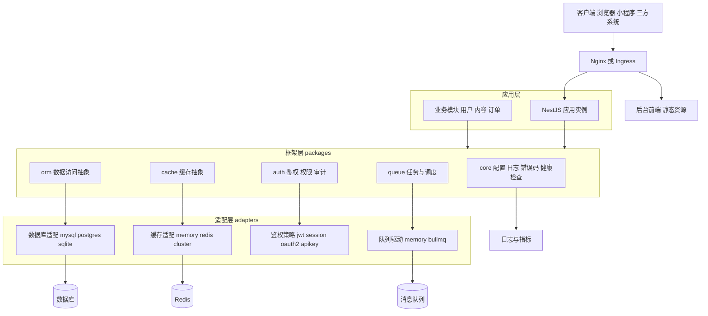
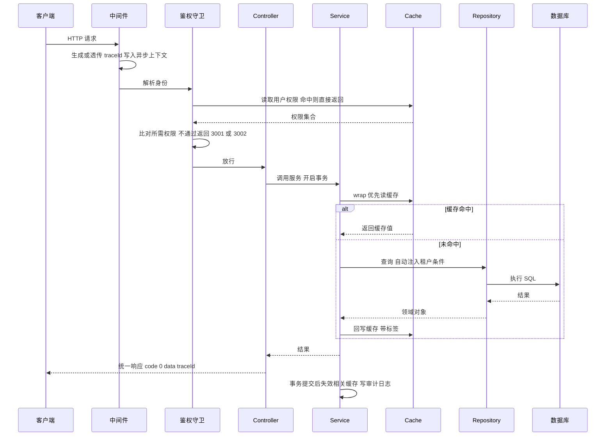

# 通用应用框架 · 架构设计与技术方案

> 版本 v0.1 ｜ 状态：草案 ｜ 关联：[愿景与范围](./00-vision-scope.md) ｜[验收标准](./10-acceptance-criteria.md) ｜ 更新：2026-10-09

## 1. 目标与约束

**目标**：一套代码库，覆盖小（单机 SQLite）到大（微服务 + 多租户）三种形态；能力可替换、规模可演进、业务代码不重写。

**硬约束**

| 约束 | 含义 |
|---|---|
| C1 零依赖起步 | 小系统不装 Redis、不起 MQ 也能跑全部功能 |
| C2 切换靠配置 | DB / 缓存 / 鉴权 / 队列的实现切换只改 `.env`，业务代码 diff = 0 |
| C3 接口优于实现 | 业务层只依赖接口，禁止直接依赖具体驱动 |
| C4 默认安全可观测 | 鉴权、审计、脱敏、限流、日志、健康检查默认开启 |
| C5 生成代码 | 产出可读可改源码，不做低代码运行时 |

## 2. 总体架构



**分层职责**

| 层 | 职责 | 禁止事项 |
|---|---|---|
| 接入层 | TLS、路由、限流、静态资源 | 不放业务逻辑 |
| 应用层 | 业务模块编排、DTO 校验、事务边界 | 不直接依赖任何驱动实现 |
| 框架层 | 通用能力（配置/日志/鉴权/数据访问/缓存/队列） | 不含任何业务语义 |
| 适配层 | 同一接口的多实现，按配置注入 | 不向上泄漏实现细节 |
| 基础设施 | DB / Redis / MQ / 对象存储 | 不自研，只适配 |

## 3. 模块职责

| 包 | 职责 | 对外接口 | 依赖 |
|---|---|---|---|
| `@fw/config` | zod 校验的配置加载、类型安全读取、多环境 | `ConfigService.get()` | 无 |
| `@fw/logger` | 结构化日志、traceId 注入、敏感字段脱敏 | `Logger.for(module)` | config |
| `@fw/core` | 启动引导、优雅停机、健康检查、统一响应与错误码 | `bootstrap()`、`HealthModule` | config、logger |
| `@fw/orm` | Repository 抽象、分页/软删/事务、迁移工具 | `Repository<T>`、`withTransaction` | config、logger |
| `@fw/cache` | 统一缓存、标签失效、三大防护、分布式锁、降级 | `CacheService`、`@Cacheable`、Lock | config、logger |
| `@fw/auth` | 认证策略、RBAC 守卫、令牌管理、审计日志 | `@Permissions`、`AuthGuard`、`AuditLog` | config、orm、cache |
| `@fw/queue` | Job 抽象、cron 调度、重试退避、死信 | `Queue.dispatch`、`@Cron`、`@JobHandler` | config、logger、cache |
| `@fw/cli` | 项目脚手架与代码生成 | `fw new / dev / build / gen` | 全部 |

## 4. 请求链路



## 5. 关键技术方案

### 5.1 配置驱动切换（核心机制）

能力切换点全部收敛到配置前缀，框架在启动时按配置注入对应实现：

| 配置键 | 取值 | 注入的实现 |
|---|---|---|
| `DB_DRIVER` | `mysql` / `postgres` / `sqlite` | 对应的 ORM 适配器与迁移器 |
| `CACHE_DRIVER` | `memory` / `redis` / `redis-cluster` | 对应 CacheStore 实现 |
| `AUTH_STRATEGY` | `jwt` / `session` / `oauth2` / `apikey` | 对应 Passport 策略（可按路由覆盖） |
| `MQ_DRIVER` | `memory` / `bullmq` | 对应 QueueTransport |
| `STORAGE_DRIVER` | `local` / `s3` / `oss` | 文件存储适配器（待规划） |

**实现要点**：所有适配器实现同一接口并以 token 注册到 DI 容器（`CACHE_STORE`、`DB_ADAPTER`…）；`ConfigModule` 启动时用 zod 校验取值，非法值启动即失败并打印可选值列表。禁止在业务代码里 `if (driver === 'redis')` 这类分支判断——差异必须下沉到适配器。

### 5.2 数据库

- Repository 接口统一（`findById / list / page / create / update / softDelete / count / withTransaction`），返回领域对象，禁止 ORM 实体泄漏到 Controller。
- **方言白名单**：禁用各库特有语法（MySQL `ON DUPLICATE KEY`、PG `jsonb` 操作符等），差异封装为适配器方法 `upsert()` / `jsonContains()`；确需原生 SQL 必须带方言标注并在 CI 双库验证。
- 迁移：一次变更一个 migration 文件，禁止修改已提交迁移；`db:migrate / db:rollback / db:seed`。
- CI 测试矩阵：单测跑 SQLite，集成测试并行跑 MySQL 8 + PostgreSQL 15，任一失败阻断合并。
- 观测：连接池可配，慢查询 > 500ms 告警并带 traceId，连接状态进入 `/ready`。

### 5.3 缓存

- 接口：`get / set / del / has / wrap / mget / expire` + `invalidateTag(tag)`；推荐用 `wrap(key, ttl, loader)` 自动回源。
- 防护内建：空值占位防穿透、单飞（single-flight）防击穿、TTL ±10% 抖动防雪崩、大 key（> 1MB）拒绝写入。
- 标签失效：标签→key 映射独立存储，支持 `user:123` 这类按对象批量失效。
- 降级：`CACHE_FAIL_OPEN=true` 时 Redis 故障转直查或 memory，并记录降级指标与告警。
- 事务协同：写操作在事务**提交后**执行失效，避免回滚导致脏数据。

### 5.4 鉴权与权限

- 链路：策略解析身份 → 加载权限（缓存） → 守卫比对 → 写入请求上下文（供审计与数据权限使用）。
- 双 token：access 2h，refresh 7d 且每次刷新轮换；旧 refresh 复用即判定泄漏，踢下线并告警（并发场景给 10s 宽限窗口）。
- RBAC：用户-角色-权限三张实体 + 两张关联表；权限点覆盖菜单 / 按钮 / 接口，编码 `资源:操作`。
- 安全加固：失败 5 次锁定 15 分钟、登录限流、密码 Argon2id、密钥双份（`JWT_SECRET` + `JWT_SECRET_PREV`）支持轮换。
- 审计：操作人 / 时间 / IP / 模块 / 动作 / 变更前后值，异步落盘不阻塞主流程，敏感字段脱敏。
- 数据权限：`dataScope` 四种范围（全部 / 本组织及下级 / 本组织 / 仅本人），M3 实现「仅本人」，M8 扩展。

### 5.5 队列与调度

- Job 抽象：`name / payload / options(attempts, backoff, delay, idempotencyKey)`，处理器实现 `handle()`。
- 驱动：`memory`（进程内，可丢失任务）与 `bullmq`（Redis 持久化），切换不改业务代码。
- 定时任务：`@Cron(expr, { lock: true })`，默认分布式锁，集群内只执行一次。
- 失败链路：指数退避重试（1s/5s/30s）→ 耗尽进死信 → 可查看原因、手动重放。
- 停机：等待在途任务完成（超时可配），未完成重新入队。

### 5.6 可观测

| 能力 | 方案 |
|---|---|
| 日志 | 结构化 JSON，字段 `time/level/traceId/spanId/module/msg/ctx`，stdout 输出，敏感字段脱敏 |
| 指标 | `/metrics` 暴露缓存命中率、队列积压、慢查询数、HTTP 延迟直方图 |
| 追踪 | OpenTelemetry（M8），traceId 贯穿 HTTP / DB / 缓存 / 队列，采样率可配、错误全采 |
| 健康 | `/health` 存活、`/ready` 依赖就绪（逐项展示 DB / Redis 状态） |

### 5.7 代码生成器约定（M6）

- 输入：Prisma schema 或已有库表反向解析 → 统一字段元信息；输出落地到 `apps/<app>/modules/<model>/`（后端）与 `web/src/views/<model>/`、`web/src/api/<model>.ts`（前端）。
- 生成物全部基于 `Repository<T>` 与 `<CrudTable>`，**不生成裸 SQL**；同时产出权限点（`<资源>:create/read/update/delete`）与菜单 seed。
- 安全写入：默认不覆盖已存在文件，`--dry` 预览，`--force` 才覆盖；业务逻辑扩展走 `*.base.ts` + 继承，重生成只覆盖 base。
- 类型映射以 [数据字典 1.3](./30-data-dictionary.md) 为准：主键与外键为 `string`、金额 `decimal` 为 `string`、普通计数为 `number`；未命中类型直接报错，不猜测。

## 6. 部署架构

| 档位 | 组件 | 编排 | 说明 |
|---|---|---|---|
| 小 | 应用单进程 + SQLite 或单 MySQL + 内存缓存 | 单机 Docker | 1C2G 可跑，无外部依赖 |
| 中 | 应用多实例 + MySQL/PG 主从 + Redis + BullMQ + Nginx | docker-compose | 无状态，可水平扩 |
| 大 | 微服务按模块拆 + Redis Cluster + Kafka + 对象存储 + 网关 | Helm / K8s | HPA、滚动更新、探针、多可用区 |

**无状态要求**：会话与令牌不落本地内存（走 Redis 或 JWT），文件走对象存储，定时任务靠分布式锁单点执行。

## 7. 演进路径

```
单体 in-process + SQLite/MySQL + memory
  → 单体多实例：改配置接入 MySQL 主从 + Redis + bullmq，编排换 compose
  → 模块拆分：被拆模块改为远程 transport，调用方代码不变
  → 平台化：多租户上下文 + Redis Cluster + Kafka + OTel + Helm
```

每一步的改动范围固定为：`.env`、transport 配置、部署编排文件；**业务模块代码不改动**。

## 8. 技术决策记录（ADR 摘要）

| 编号 | 决策 | 备选 | 理由 | 状态 |
|---|---|---|---|---|
| [0001](./adr/0001-backend-framework-nestjs.md) | 后端框架采用 NestJS | Express 裸写 / Fastify | 模块化 + DI 天然适合做框架，单体与微服务同构 | 已采纳 |
| [0002](./adr/0002-orm-selection.md) | ORM 选型：Prisma 或 TypeORM | MikroORM | schema 清晰 vs 装饰器贴合；M2 开工前按评估项定稿 | 待定 |
| [0003](./adr/0003-monorepo-pnpm-turborepo.md) | monorepo + pnpm workspace + Turborepo | 多仓库 + npm | 模板可直接联调框架源码，构建缓存复用 | 已采纳 |
| [0004](./adr/0004-cache-abstraction.md) | 缓存抽象基于 cache-manager + ioredis | 自研封装 | 统一接口 + 多 store，切换成本低 | 已采纳 |
| [0005](./adr/0005-auth-passport-rbac.md) | 鉴权 Passport + 自研 RBAC | Casbin | 策略可插拔；RBAC 五表足够，ABAC 需求再引 Casbin | 已采纳 |
| [0006](./adr/0006-frontend-vue3-element-plus.md) | 后台前端 Vue3 + Element Plus | React + AntD | 后台生态成熟、体积小；React 模板后续补 | 已采纳 |
| [0007](./adr/0007-database-switchability.md) | 可切换 = 方言白名单 + 静态检查 + 三库 CI | 只依赖 ORM | 核心卖点需要可执行保障机制 | 已采纳 |
| [0008](./adr/0008-testing-strategy.md) | 测试：SQLite 单测 + 双库集成矩阵 | 全部用容器库 | 本地反馈快，方言差异由 CI 双库兜底 | 已采纳 |
| [0009](./adr/0009-code-generation-over-lowcode.md) | 快速开发靠代码生成，不做低代码引擎 | 元数据驱动渲染 | 产出可读可改源码，不锁死业务 | 已采纳 |
| [0010](./adr/0010-observability-otel.md) | 可观测：先统一 traceId，M8 再引入 OTel | 自研 traceId 导出 | M1 先打通链路，小档零额外组件 | 已采纳 |

> 完整决策记录见 [ADR 目录](./adr/README.md)；编号以目录内文件为准（0001–0010），决策只增不改。

## 9. 风险与对策

| 风险 | 影响 | 对策 |
|---|---|---|
| 方言差异导致切换失败 | 违背核心卖点 | 白名单 + 适配器封装 + CI 三库矩阵 + 原生 SQL 静态检查 |
| 权限缓存与变更不一致 | 越权或误拦截 | 变更时按标签主动失效；关键操作二次查库校验 |
| 过早微服务化拖慢小项目 | 复杂度失控 | 文档明确单体优先，达量化阈值（模块 QPS 差异 / 团队边界）才拆 |
| 共享库多租户漏条件即越权 | 数据安全事故 | Repository 强制注入租户条件 + 缺失上下文 fail-closed + 越权用例门禁 |
| 生成器覆盖手写业务逻辑 | 返工 | `--force` 才覆盖 + diff 预览 + 生成 `*.base.ts` 与业务类分离 |
| 异步上下文丢失 | traceId 断链 | M2 联调验证，必要时显式传参兜底 |

## 10. 与 PRD 的映射

| 本文档章节 | 对应 PRD |
|---|---|
| 3 模块职责、5.1 配置切换、5.6 可观测 | [PRD-001](./prd/prd-001-core-skeleton.md) |
| 5.2 数据库 | [PRD-002](./prd/prd-002-database-abstraction.md) |
| 5.4 鉴权与权限 | [PRD-003](./prd/prd-003-auth-rbac.md) |
| 5.3 缓存 | [PRD-004](./prd/prd-004-cache-layer.md) |
| 6 部署架构（后台模板产物）、[原型与 UI](./25-ui-prototype.md) | [PRD-005](./prd/prd-005-admin-template.md) |
| 5.7 生成器约定 | [PRD-006](./prd/prd-006-code-generator.md) |
| 5.5 队列与调度 | [PRD-007](./prd/prd-007-queue-scheduler.md) |
| 5.6 追踪、7 演进路径 | [PRD-008](./prd/prd-008-multitenancy-scale.md) |

## 11. 文档交叉核对

各文档与本项目的一致性核对结果见 [文档一致性核对报告](./95-doc-audit.md)。
