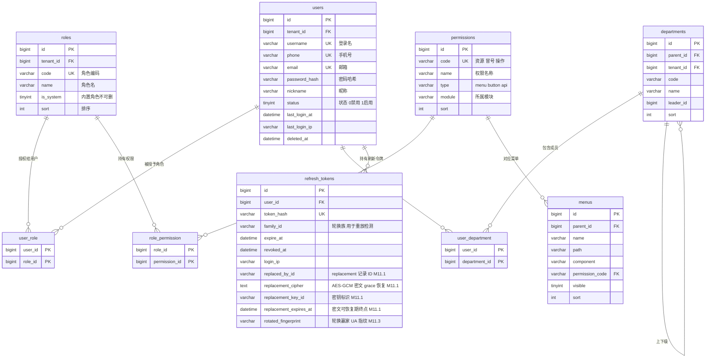
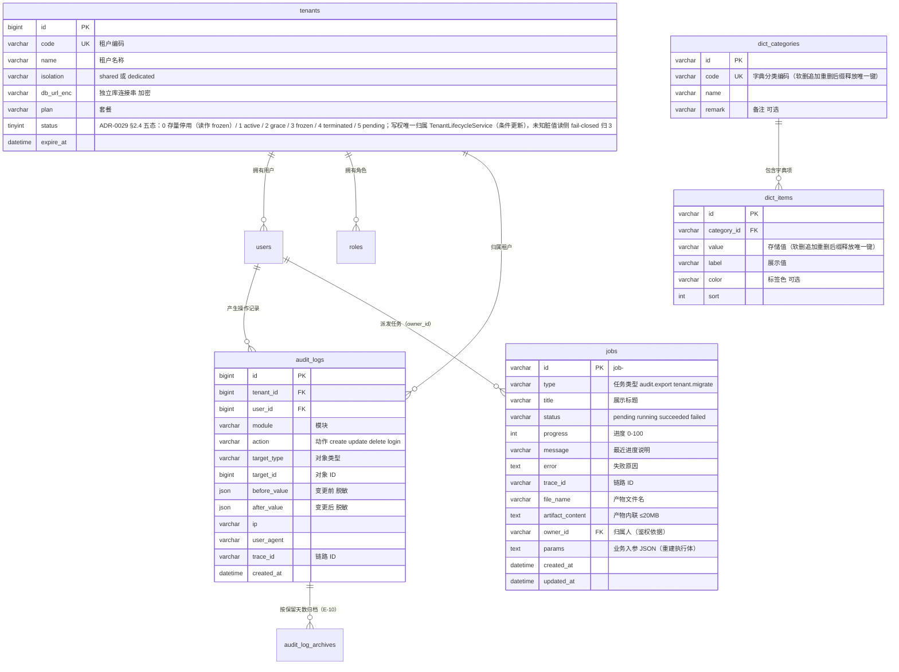

# 通用应用框架 · ER 图与数据字典

> 版本 v0.1 ｜ 状态：草案 ｜ 关联：[架构设计](./20-architecture.md) ｜ [PRD-003 鉴权](./prd/prd-003-auth-rbac.md) ｜ 更新：2026-10-14
>
> 说明：表结构按**领域分组**给出；标注 `M8` 的表属于后续里程碑，字段可能调整。`job_records` 是 M7 的规划模型，当前 memory/bullmq 实现未创建该业务表；示例业务表（`orders`）仅用于说明代码生成器的字段约定，不属于框架必需表。
> `departments` / `user_department`（§3.7/§3.8）已于 M8 T-M8-04 落地（含数据权限四档解析），主键为 UUID 字符串（与 M3 各表一致，字典中的 bigint 为逻辑描述）。

## 1. 建模约定

### 1.1 命名规范

| 对象 | 规则 | 示例 |
|---|---|---|
| 表名 | 小写下划线、复数；**框架表不带前缀**（`users`、`roles`、`dict_items`），业务表可带模块前缀（`order_items`） | `users`、`sys_dict_items` → 框架表统一用 `dict_items` |
| 字段名 | 小写下划线 | `created_at`、`tenant_id` |
| 外键 | `<单表>_id` | `role_id`、`user_id` |
| 关联表 | `<主体>_<客体>`（语义顺序，非字母序） | `user_role`、`role_permission`、`user_department` |
| 布尔字段 | `is_` 前缀 | `is_system`、`is_enabled` |
| 时间字段 | `_at` 后缀 | `last_login_at`、`expire_at` |
| 索引 | `idx_<表>_<字段>` / `uk_<表>_<字段>` | `uk_users_username` |

### 1.2 通用字段（除关联表外所有表必备）

| 字段 | 类型 | 说明 |
|---|---|---|
| `id` | bigint | 主键，雪花 ID 或 bigint 自增（两种策略可配，**全库统一**）；**传输与 TS 类型一律 `string`**，避免大整数精度丢失 |
| `tenant_id` | bigint | 租户 ID；shared 隔离下必填，M8 生效，M1–M7 预留并默认 0 |
| `created_by` | bigint | 创建人 |
| `updated_by` | bigint | 更新人 |
| `created_at` | datetime(3) | 创建时间 |
| `updated_at` | datetime(3) | 更新时间 |
| `deleted_at` | datetime(3) | 软删除标记，NULL 为未删除 |
| `version` | int | 乐观锁版本号，写操作 +1（**条件必选**：仅并发敏感表启用，普通表可不建） |

> 以下字典中为简洁起见，通用字段在每张表中只列差异字段 + `通用字段` 占位行，不再重复展开。

### 1.3 类型对照

| 数据库类型 | TS 类型 | 前端控件 | 校验 |
|---|---|---|---|
| `varchar(n)` / `char(n)` | `string` | 输入框 | 长度 ≤ n |
| `text` / `longtext` | `string` | 文本域 | — |
| `int` | `number` | 数字框 / 步进器 | 整数范围（仅非 ID 的计数、数量、排序值） |
| `bigint`（主键 `id` 或外键 `*_id`） | **`string`** | 只读 / 关联选择器 | 存在性校验；**禁止用 `number`**（雪花 ID 超出安全整数范围） |
| `decimal(p,s)` | `string`（金额禁止用浮点） | 金额框 | 精度校验，字符串传输（见 [API 1.1](./40-api-spec.md)） |
| `tinyint(1)` / `boolean` | `boolean` | 开关 | — |
| `enum(...)` | 联合字面量 | 下拉 | 枚举值白名单 |
| `datetime(3)` / `date` | `string`（ISO 8601） | 日期时间选择器 | 时间格式 |
| `json` | `Record<string, unknown>` | JSON 编辑器（默认只读） | JSON 校验 |
| `<xx>_id` | `string` | 关联选择器 | 存在性校验 |

### 1.4 其它约定

- **金额**：一律 `decimal(18,2)`，禁止浮点；**时间**：一律 UTC 存储、展示层转本地时区。
- **软删除**：默认软删，查询自动带 `deleted_at IS NULL`；物理删除需显式声明并记审计。
- **索引**：所有外键与高频筛选字段建索引；唯一约束用 `uk_` 前缀并显式命名（便于迁移幂等）。
- **外键物理约束**：仅在同一库内、且确认不影响迁移顺序时使用；跨服务与分库场景用逻辑外键。
- **枚举**：优先用 `dict_items` 字典（可运营配置），仅不变的技术枚举用数据库 `enum`。

## 2. ER 图

### 2.1 权限与组织域（M3 建立，M8 扩展组织）

### 2.2 系统与租户域（审计 M3、租户 M8、任务登记 M10）

## 3. 数据字典

### 3.1 `users` 用户（M3）

| 字段 | 类型 | 必填 | 默认 | 说明 | 索引 |
|---|---|---|---|---|---|
| `id` | bigint | 是 | — | 主键 | PK |
| `tenant_id` | bigint | 是 | 0 | 租户 ID（M8） | `idx_users_tenant` |
| `username` | varchar(64) | 是 | — | 登录名，3–32 位 | UK |
| `phone` | varchar(20) | 否 | NULL | 手机号 | UK（非空时唯一） |
| `email` | varchar(128) | 否 | NULL | 邮箱 | UK（非空时唯一） |
| `password_hash` | varchar(255) | 是 | — | Argon2id 哈希，永不明文 | — |
| `nickname` | varchar(64) | 否 | NULL | 昵称 | — |
| `avatar` | varchar(255) | 否 | NULL | 头像地址 | — |
| `status` | tinyint | 是 | 1 | 0 禁用 / 1 启用 | `idx_users_status` |
| `last_login_at` | datetime(3) | 否 | NULL | 最近登录时间 | — |
| `last_login_ip` | varchar(45) | 否 | NULL | 最近登录 IP（IPv6 兼容） | — |
| 通用字段 | — | — | — | `created_by/updated_by/created_at/updated_at/deleted_at` | — |

### 3.2 `roles` 角色（M3）

| 字段 | 类型 | 必填 | 默认 | 说明 | 索引 |
|---|---|---|---|---|---|
| `id` | bigint | 是 | — | 主键 | PK |
| `tenant_id` | bigint | 是 | 0 | 租户 ID | `idx_roles_tenant` |
| `code` | varchar(64) | 是 | — | 角色编码，如 `admin` | UK（租户内唯一） |
| `name` | varchar(64) | 是 | — | 角色名 | — |
| `remark` | varchar(255) | 否 | NULL | 备注 | — |
| `is_system` | tinyint | 是 | 0 | 内置角色不可删除 | — |
| `data_scope` | varchar(20) | 是 | `self` | 数据范围：`all` / `org_below` / `org` / `self` | — |
| `sort` | int | 是 | 0 | 排序 | — |
| 通用字段 | — | — | — | 同上 | — |

### 3.3 `permissions` 权限点（M3）

| 字段 | 类型 | 必填 | 默认 | 说明 | 索引 |
|---|---|---|---|---|---|
| `id` | bigint | 是 | — | 主键 | PK |
| `code` | varchar(128) | 是 | — | `资源:操作`，如 `order:refund` | UK |
| `name` | varchar(64) | 是 | — | 权限名称 | — |
| `type` | varchar(16) | 是 | `api` | `menu` / `button` / `api` | `idx_permissions_type` |
| `module` | varchar(64) | 否 | NULL | 所属模块，便于分组展示 | `idx_permissions_module` |
| `sort` | int | 是 | 0 | 排序 | — |
| 通用字段 | — | — | — | 同上 | — |

### 3.4 `user_role` 用户-角色（M3，关联表）

| 字段 | 类型 | 必填 | 说明 | 索引 |
|---|---|---|---|---|
| `user_id` | bigint | 是 | 用户 ID | 联合 PK + `idx_ur_role` |
| `role_id` | bigint | 是 | 角色 ID | 联合 PK + `idx_ur_user` |

### 3.5 `role_permission` 角色-权限（M3，关联表）

| 字段 | 类型 | 必填 | 说明 | 索引 |
|---|---|---|---|---|
| `role_id` | bigint | 是 | 角色 ID | 联合 PK |
| `permission_id` | bigint | 是 | 权限 ID | 联合 PK |

### 3.6 `menus` 菜单（M3，供后台动态路由）

| 字段 | 类型 | 必填 | 默认 | 说明 | 索引 |
|---|---|---|---|---|---|
| `id` | bigint | 是 | — | 主键 | PK |
| `parent_id` | bigint | 是 | 0 | 父菜单，0 为顶级 | `idx_menus_parent` |
| `name` | varchar(64) | 是 | — | 菜单名 | — |
| `path` | varchar(255) | 否 | NULL | 前端路由 | — |
| `component` | varchar(255) | 否 | NULL | 前端组件路径 | — |
| `icon` | varchar(64) | 否 | NULL | 图标 | — |
| `permission_code` | varchar(128) | 否 | NULL | 关联权限点，控制可见性 | `idx_menus_perm` |
| `visible` | tinyint | 是 | 1 | 是否显示 | — |
| `sort` | int | 是 | 0 | 排序 | — |
| 通用字段 | — | — | — | 同上 | — |

### 3.7 `departments` 组织部门（M8）

| 字段 | 类型 | 必填 | 默认 | 说明 | 索引 |
|---|---|---|---|---|---|
| `id` | bigint | 是 | — | 主键 | PK |
| `parent_id` | bigint | 是 | 0 | 上级部门；'0' 为顶级 | `idx_dept_parent` |
| `tenant_id` | bigint | 是 | 0 | 租户 ID | `idx_dept_tenant` |
| `code` | varchar(64) | 否 | NULL | 部门编码 | UK（租户内唯一） |
| `name` | varchar(64) | 是 | — | 部门名 | — |
| `leader_id` | bigint | 否 | NULL | 负责人（users.id） | — |
| `sort` | int | 是 | 0 | 排序 | — |
| 通用字段 | — | — | — | 同上 | — |

> 实现说明（M8 T-M8-04）：与 users/roles 等 M3 表同构，主键与外键均为 UUID 字符串（字典中的 bigint 为逻辑描述）。
> 数据权限四档语义（PRD-008 FR-04）：`org` = 本人所在部门成员；`org_below` = 所在部门及全部下级（闭包，经 `@fw/auth` 的 `collectDescendantIds` 计算）；
> 用户无部门归属时一律收敛为 `self`（fail-closed）。部门树暂不提供维护端点，由种子与运维脚本维护（Backlog）。

### 3.8 `user_department` 用户-部门（M8，关联表，支持多部门）

| 字段 | 类型 | 必填 | 说明 | 索引 |
|---|---|---|---|---|
| `user_id` | bigint | 是 | 用户 ID | 联合 PK |
| `department_id` | bigint | 是 | 部门 ID | 联合 PK |
| `is_primary` | tinyint | 否 | 是否主部门（默认 0） | — |

### 3.9 `refresh_tokens` 刷新令牌（M3）

| 字段 | 类型 | 必填 | 默认 | 说明 | 索引 |
|---|---|---|---|---|---|
| `id` | bigint | 是 | — | 主键 | PK |
| `user_id` | bigint | 是 | — | 用户 ID | `idx_rt_user` |
| `token_hash` | varchar(255) | 是 | — | 令牌哈希（不存明文） | UK |
| `family_id` | varchar(64) | 是 | — | 轮换族 ID，复用旧令牌即判定泄漏 | `idx_rt_family` |
| `expire_at` | datetime(3) | 是 | — | 过期时间（默认 7 天） | `idx_rt_expire` |
| `revoked_at` | datetime(3) | 否 | NULL | 撤销时间（登出/轮换/踢下线） | — |
| `login_ip` | varchar(45) | 否 | NULL | 登录 IP | — |
| `user_agent` | varchar(255) | 否 | NULL | 客户端标识 | — |
| `replaced_by_id` | varchar(36) | 否 | NULL | 本记录轮换出的 replacement 记录 ID（M11.1，ADR-0020） | `idx_rt_replaced_by` |
| `replacement_cipher` | text | 否 | NULL | replacement 明文的 AES-256-GCM 密文 `v1:keyId:iv:ct:tag`（grace 恢复专用，明文永不落库；M11.1） | — |
| `replacement_key_id` | varchar(64) | 否 | NULL | replacement 密钥标识（M11.1 单密钥 `replacement-v1`，M11.4 Key Ring 扩展） | — |
| `replacement_expires_at` | datetime(3) | 否 | NULL | replacement 密文可恢复期终点（= 轮换时刻 + 宽限窗口，与 `revoked_at` 同一时间基准） | — |
| `rotated_fingerprint` | varchar(64) | 否 | NULL | 轮换赢家客户端指纹 SHA-256(normalizeUserAgent)（M11.3，ADR-0022；IP 不参与）；grace 重试比对，不匹配判泄漏族撤销；NULL 仅存量/off 来源 | — |
| 通用字段 | — | — | — | 同上 | — |

> 清理策略：过期 30 天以上的记录由定时任务清理。
> M11.1（ADR-0020）：轮换经存储层 CAS 原子裁决（`UPDATE ... WHERE revoked_at IS NULL AND deleted_at IS NULL AND expires_at > now`，
> affectedRows===1 即赢家，同事务插入 replacement），并发/重试路径解密 `replacement_cipher` 返回同一个 B，绝不二次签发；
> grace 外复用判定为泄漏并整族撤销。migration：`20261016140000_add_refresh_replacement`（SQLite/PG 双方言同构）。

### 3.10 `tenants` 租户（M8）

| 字段 | 类型 | 必填 | 默认 | 说明 | 索引 |
|---|---|---|---|---|---|
| `id` | bigint | 是 | — | 主键 | PK |
| `code` | varchar(64) | 是 | — | 租户编码（子域名/请求头匹配） | UK |
| `name` | varchar(128) | 是 | — | 租户名称 | — |
| `isolation` | varchar(16) | 是 | `shared` | `shared`（共享库 + tenant_id）/`dedicated`（独立库） | — |
| `db_url_enc` | varchar(512) | 否 | NULL | 独立库连接串（加密存储，仅 dedicated 使用） | — |
| `plan` | varchar(32) | 否 | NULL | 套餐 | — |
| `status` | tinyint | 是 | 1 | 五态 Int 编码（ADR-0029 §2.4）：0 存量停用（读作 frozen，只读兼容）/ 1 active / 2 grace / 3 frozen / 4 terminated / 5 pending | — |
| `expire_at` | datetime(3) | 否 | NULL | 到期时间 | — |
| 通用字段 | — | — | — | 同上 | — |

> `db_url_enc` 加密格式（M8 T-M8-02）：AES-256-GCM 认证加密，密文形态 `v1.<iv-b64url>.<tag-b64url>.<ct-b64url>`；
> 密钥取环境变量 `TENANT_DB_KEY`（64 位十六进制或 base64，缺省用内置开发密钥并告警，生产必须显式配置）。
> 解密只发生在租户存储适配层，明文经进程内请求上下文传递给数据源路由，禁止写入日志/审计/队列消息。
> sqlite 相对路径（`file:./xxx.db`）按 `prisma/schema.prisma` 所在目录解析，与主库 `DB_URL` 语义一致。

### 3.11 `dict_categories` 字典分类（M5 契约声明，2026-10-14 落地）

| 字段 | 类型 | 必填 | 默认 | 说明 | 索引 |
|---|---|---|---|---|---|
| `id` | varchar(36) | 是 | uuid | 主键（框架统一字符串主键，D-04） | PK |
| `code` | varchar(64) | 是 | — | 分类编码，如 `order_status`、`user_status` | UK（全局唯一） |
| `name` | varchar(64) | 是 | — | 分类名称 | — |
| `remark` | varchar(255) | 否 | NULL | 备注 | — |
| 通用字段 | — | — | — | 含软删 / 审计字段 | `idx_dict_cat_deleted` |

> 与 `permissions` / `menus` 同属**系统级配置**，故不带 `tenant_id`（多租户下字典全局共享，与 D-03「框架表不带前缀」一致）。
> 软删时 `code` 追加重删后缀释放唯一键——否则同编码分类永远无法重建（人员复用场景直接撞 409）。

### 3.12 `dict_items` 字典项（M5 契约声明，2026-10-14 落地）

| 字段 | 类型 | 必填 | 默认 | 说明 | 索引 |
|---|---|---|---|---|---|
| `id` | varchar(36) | 是 | uuid | 主键 | PK |
| `category_id` | varchar(36) | 是 | — | 所属分类 | `idx_dict_item_category` |
| `value` | varchar(64) | 是 | — | 存储值（程序值） | UK（分类内唯一） |
| `label` | varchar(64) | 是 | — | 展示文案 | — |
| `color` | varchar(32) | 否 | NULL | 标签色，取值 `primary/success/warning/danger/info` | — |
| `sort` | int | 是 | 0 | 排序 | — |
| 通用字段 | — | — | — | 含软删 / 审计字段 | `idx_dict_item_deleted` |

> 契约（C-06 §3.6）不含 `is_default`：默认值由前端表单自行决定，落库会把「展示策略」固化进数据层，故不建。
> 软删时 `value` 追加重删后缀释放 `(category_id, value)` 唯一键，理由同分类。
> 种子基线四类：`user_status`（用户管理页）、`data_scope`（角色数据范围四档）、`audit_action`（审计筛选）、`order_channel`（订单演示页）。

### 3.13 `audit_logs` 审计日志（M3）

| 字段 | 类型 | 必填 | 默认 | 说明 | 索引 |
|---|---|---|---|---|---|
| `id` | bigint | 是 | — | 主键 | PK |
| `tenant_id` | bigint | 是 | 0 | 租户 ID | `idx_audit_tenant` |
| `user_id` | bigint | 否 | NULL | 操作人（系统任务为 NULL） | `idx_audit_user` |
| `module` | varchar(64) | 是 | — | 模块名 | — |
| `action` | varchar(32) | 是 | — | `create` / `update` / `delete` / `login` / `export` | `idx_audit_action` |
| `category` | varchar(32) | 否 | NULL | 审计大类（PRD-012 OBS-06：`auth` / `security` / `admin` / `data` / `config` / `tenant` / `system`，低基数粗筛键） | `idx_audit_category_created` |
| `event` | varchar(64) | 否 | NULL | 点分事件名（如 `refresh.replay_detected` / `auth.login`，细分检索键） | `idx_audit_event` |
| `result` | varchar(16) | 否 | NULL | 事件结果：`success` / `denied` / `failed` | — |
| `family_id` | varchar(36) | 否 | NULL | 令牌家族 ID（M11.1 rotation family，安全事件关联键） | `idx_audit_family` |
| `jti` | varchar(64) | 否 | NULL | 令牌标识（非令牌本体，可安全落库） | — |
| `request_id` | varchar(64) | 否 | NULL | 单次请求 ID（PRD-012 OBS-09，W2 起填充；本列随 OBS-06 先行落位） | `idx_audit_request` |
| `target_type` | varchar(64) | 否 | NULL | 对象类型 | `idx_audit_target` |
| `target_id` | bigint | 否 | NULL | 对象 ID | `idx_audit_target` |
| `before_value` | json | 否 | NULL | 变更前（脱敏后） | — |
| `after_value` | json | 否 | NULL | 变更后（脱敏后） | — |
| `ip` | varchar(45) | 否 | NULL | 来源 IP | — |
| `user_agent` | varchar(255) | 否 | NULL | 客户端标识 | — |
| `trace_id` | varchar(64) | 否 | NULL | 链路 ID，串联日志 | `idx_audit_trace` |
| `created_at` | datetime(3) | 是 | — | 操作时间（仅创建，不更新不删除） | `idx_audit_created` |

> 保留期默认 180 天可配（`AUDIT_ARCHIVE_RETENTION_DAYS`，M10 E-10 起）：早于保留线的记录由定时任务
> `audit.archive`（每天 02:00，分布式锁多副本单执行）迁入 §3.17 的 `audit_log_archives` 冷存表，在线表行数持续有界；
> 查询页按 `user_id + created_at` 组合查询。
>
> M12 W1（PRD-012 OBS-06，ADR-0025）起本表承载**统一审计事件契约**：`category` / `event` / `result` /
> `family_id` / `jti` / `request_id` 六列为软增列（全 nullable，migration `20261017110000` 三方言同构，
> 旧数据 / 旧代码零回归）；`AuditService` 落盘时**字段全量落位**（缺省 NULL，序列化形状不漂移）。
> replay 安全事件按 `category='security' + event='refresh.replay_detected' + result='denied'` 落库，
> `trace_id` 取自请求上下文（OBS-07 断链修复），`reason`（低基数结构化原因）与人读 `detail` 在 `after_value` 内。

### 3.14 `jobs` 任务登记表（M7 规划为 `job_records`；M10 E-01 落地为 `jobs`）

> M7 的规划模型未迁移；M10 E-01（任务中心驱动化）按 N-02 任务中心的实际语义落地为 `jobs` 表——
> `JOB_CENTER_DRIVER=db / bullmq` 时的任务登记持久层（memory 驱动不建此表，进程内持有）。
> 多副本语义：任意实例可查进度 / 下载产物 / 重跑（AC1），重跑经 `JobRunnerRegistry` 按类型重建执行体。

| 字段 | 类型 | 必填 | 默认 | 说明 | 索引 |
|---|---|---|---|---|---|
| `id` | varchar(36) | 是 | — | 主键（`job-<uuid>`，派发侧生成） | PK |
| `type` | varchar(64) | 是 | — | 任务类型（如 `audit.export` / `tenant.migrate`） | — |
| `title` | varchar(128) | 是 | — | 展示标题（前端任务条文案） | — |
| `status` | varchar(16) | 是 | `pending` | `pending` / `running` / `succeeded` / `failed` | `idx_jobs_status` |
| `progress` | int | 是 | 0 | 进度百分比 0–100（只增不减） | — |
| `message` | varchar(255) | 否 | NULL | 最近一条进度说明 | — |
| `error` | text | 否 | NULL | 失败原因（status=failed 时非空） | — |
| `trace_id` | varchar(64) | 否 | NULL | 链路 ID（与日志 / 审计一致） | — |
| `file_name` | varchar(255) | 否 | NULL | 产物文件名（status=succeeded 时非空） | — |
| `artifact_content` | text（MySQL 建议 LONGTEXT） | 否 | NULL | 产物文本内联（≤20MB，OQ-1 决议：E-09 落地后可切对象存储） | — |
| `artifact_content_type` | varchar(64) | 否 | NULL | 产物 MIME 类型 | — |
| `owner_id` | varchar(36) | 是 | — | 归属人（进度/下载/重跑的鉴权依据） | `idx_jobs_owner_created`（与 created_at 组合） |
| `params` | text（JSON 字符串） | 否 | NULL | 业务入参（跨实例重跑按它重建执行体；连接串等敏感值以密文形态入参） | — |
| `created_at` / `updated_at` | datetime(3) | 是 | now / 自动 | 审计时间（无软删：裁剪策略只删已结束的最旧任务） | — |

> 裁剪语义与 memory 驱动一致：登记上限 200 条，超出丢弃最旧的**已结束**任务（running/pending 永不裁剪）。
> 并发重跑竞态由 `WHERE status='failed'` 条件更新消解（两个实例同时点重跑只成功一个）。

### 3.15 示例业务表 `orders`（演示生成器约定）

| 字段 | 类型 | 必填 | 默认 | 说明 | 索引 |
|---|---|---|---|---|---|
| `id` | bigint | 是 | — | 主键 | PK |
| `order_no` | varchar(32) | 是 | — | 订单号 | UK |
| `user_id` | bigint | 是 | — | 下单用户（外键语义） | `idx_order_user` |
| `amount` | decimal(18,2) | 是 | 0 | 金额 | — |
| `status` | varchar(24) | 是 | `pending` | 状态，取值来自 `dict_items` | `idx_order_status` |
| `paid_at` | datetime(3) | 否 | NULL | 支付时间 | — |
| 通用字段 | — | — | — | 含 `tenant_id` / 软删 / 审计字段 | — |

> 生成器依据此约定产出：后端 Entity/DTO/Service/Controller、前端列表与表单、四个权限点（`order:create/read/update/delete`）与菜单 seed。

### 3.16 `config_snapshots` 配置快照历史（M10 E-02）

> 配置中心多实例语义持久层：`CONFIG_CENTER_ENABLED=true` 时装配——快照历史与版本号基线下沉此表，
> A 实例写入的版本对 B 实例可见（回滚跨实例一致，PRD-010 AC2），meta.snapshotVersion 读取经持久层对齐。
> 保留最近 20 版（与框架环形表上限同口径），超出淘汰最旧；`memory` 语义（不注入持久历史）为缺省行为。

| 字段 | 类型 | 必填 | 默认 | 说明 | 索引 |
|---|---|---|---|---|---|
| `version` | int | 是 | — | 快照版本号（主键；与 meta.snapshotVersion 同口径，append 为 upsert 语义） | PK |
| `overlay` | text（JSON 字符串） | 是 | — | 该版本生效时刻的运行时覆盖集（点路径 → 覆盖值；不含 env 基线） | — |
| `applied_at` | datetime(3) | 是 | — | 该版本生效时间 | — |

### 3.17 `audit_log_archives` 审计归档（M10 E-10）

> 在线表 `audit_logs` 按保留天数迁入的冷存副本（PRD-010 AC7：在线表行数回落，大体量审计不拖垮在线查询）。
> 归档任务先写本表再删在线表：写入按主键 **upsert 幂等**（崩溃重跑覆盖同 id 不产生重复），失败绝不删在线（fail-closed）。
> 本表只增不改不删（冷数据），字段与 §3.13 逐项同构（`id` 与在线表一致），另加 `archived_at` 登记归档时刻。
> 冷数据出口：`GET /api/v1/audit-archives`（查询，dataScope 同源收敛）与 `GET /api/v1/audit-archives/export`（异步导出）。

| 字段 | 类型 | 必填 | 默认 | 说明 | 索引 |
|---|---|---|---|---|---|
| `id` | varchar(36) | 是 | — | 主键（与在线表 `audit_logs.id` 一致，幂等 upsert 依据） | PK |
| `tenant_id` | bigint | 是 | 0 | 租户 ID（沿在线表） | — |
| `user_id` | varchar(36) | 否 | NULL | 操作人（沿在线表） | `idx_audit_archive_user` |
| `module` | varchar(64) | 是 | — | 模块名（沿在线表） | `idx_audit_archive_module` |
| `action` | varchar(32) | 是 | — | 动作（沿在线表） | — |
| `category` / `event` / `result` / `family_id` / `jti` / `request_id` | varchar | 否 | NULL | 统一审计事件契约（PRD-012 OBS-06，与在线表同构软增列） | `idx_audit_archive_event` / `idx_audit_archive_family` / `idx_audit_archive_request` / `idx_audit_archive_category` |
| `target_type` / `target_id` | varchar(64) | 否 | NULL | 对象类型 / ID（沿在线表） | — |
| `before_value` / `after_value` | json | 否 | NULL | 变更前 / 后（脱敏后，沿在线表） | — |
| `ip` | varchar(45) | 否 | NULL | 来源 IP（沿在线表） | — |
| `user_agent` | varchar(255) | 否 | NULL | 客户端标识（沿在线表） | — |
| `trace_id` | varchar(64) | 否 | NULL | 链路 ID（沿在线表） | — |
| `created_at` | datetime(3) | 是 | — | 操作时间（沿在线表，迁移查询的排序键） | `idx_audit_archive_created` |
| `archived_at` | datetime(3) | 是 | now | 归档时刻 | — |

### 3.18 `notifications` 站内信（M10 E-13）

> 通知中心持久层：业务侧经 `@fw/transport` 事件面订阅（任务终态 / 队列告警）落成**收件人可见**的消息，
> 前端顶栏铃铛消费未读数。`dedupe_key` **唯一**——事件面可能重复投递（多副本各起一条订阅、
> 任务重试后再次终态），幂等靠唯一约束而非应用层「先查后写」（并发插入只有一个成功）。
> 归属人（`user_id`）即读 / 标已读 / 删除的权限边界；`tenant_id` 为逻辑外键（沿本仓跨库约定，
> 不建物理外键）。保留窗口：每人最多 200 条，超出淘汰最旧（提醒不是档案，避免无界增长拖慢未读计数）。
> 归档与清理：本表随用户保留策略处理，属可物理删的运营数据（与审计类只增不删的表不同）。

| 字段 | 类型 | 必填 | 默认 | 说明 | 索引 |
|---|---|---|---|---|---|
| `id` | varchar(36) | 是 | uuid | 主键（`ntf-<uuid>`） | PK |
| `tenant_id` | bigint | 是 | 0 | 租户 ID（逻辑外键 → `tenants.id`） | — |
| `user_id` | varchar(36) | 是 | — | 收件人（逻辑外键 → `users.id`；读 / 标已读 / 删除的边界） | `idx_notifications_user_created` / `idx_notifications_user_read` |
| `kind` | varchar(32) | 是 | — | 业务类型：`job.finished` / `job.failed` / `queue.dead-letter` / `queue.backlog` / `system` | — |
| `level` | varchar(16) | 是 | info | 展示级别：`info` / `success` / `warning` / `error`（前端着色） | — |
| `title` | varchar(255) | 是 | — | 标题（列表第一行） | — |
| `content` | text | 否 | NULL | 正文摘要（失败原因 / 产物文件名等） | — |
| `ref_type` | varchar(32) | 否 | NULL | 关联资源类型：`job` / `queue` / NULL | — |
| `ref_id` | varchar(64) | 否 | NULL | 关联资源 ID（如 jobId，供溯源） | — |
| `trace_id` | varchar(64) | 否 | NULL | 链路 ID（与日志 / 审计一致，报障用） | — |
| `dedupe_key` | varchar(128) | 是 | — | 幂等键（如 `job:<jobId>:<status>:<updatedAt>`；广播消息追加 `:<userId>`） | **UNIQUE** `notifications_dedupe_key_key` |
| `read_at` | datetime(3) | 否 | NULL | 已读时刻（未读为 NULL；未读计数即本列 IS NULL 的行数） | 见上（组合索引） |
| `created_at` | datetime(3) | 是 | now | 产生时刻（列表排序键，倒序） | 见上（组合索引） |

### 3.19 `upload_files` 附件元数据（M10 E-09）

> 文件存储端口 `@fw/storage`（PRD-010 E-09）的元数据表：**文件内容不在库**——经 StoragePort
> 落地（`STORAGE_DRIVER=local` 本地磁盘 / `s3` S3 兼容对象存储，切换只改配置），本表只存元数据与归属。
> 存储 key 即 `stored_name`（`<yyyyMM>/<uuid><ext>`，服务端生成，不透传用户输入，天然免疫路径穿越）。
> 上传类型 / 大小白名单默认收紧（20MB + 扩展名白名单，`STORAGE_MAX_MB` / `STORAGE_ALLOWED_EXTS` 可调）；
> 软删（`deleted_at`）后元数据与下载面均视为不存在（不泄露存在性）。端点契约见 api-spec §3.16。
> 附件字段约定：业务表的 `*FileId` / `*AttachmentId` String 列存本表 `id`（codegen 识别生成上传控件），
> 无物理外键（沿本仓跨库约定）。

| 字段 | 类型 | 必填 | 默认 | 说明 | 索引 |
|---|---|---|---|---|---|
| `id` | varchar(36) | 是 | uuid | 主键 | PK |
| `owner_id` | varchar(36) | 否 | NULL | 上传人（逻辑外键 → `users.id`；配额与归属追溯用） | `idx_upload_owner` |
| `original_name` | varchar(255) | 是 | — | 原始文件名（仅展示；不参与存储 key） | — |
| `stored_name` | varchar(128) | 是 | — | 存储 key（`<yyyyMM>/<uuid><ext>`；StoragePort 读写地址） | — |
| `mime_type` | varchar(128) | 是 | — | MIME 类型（下载回传 Content-Type） | — |
| `size` | int | 是 | — | 字节数 | — |
| `deleted_at` | datetime(3) | 否 | NULL | 软删时刻（非 NULL 即对业务不可见） | — |
| `created_at` | datetime(3) | 是 | now | 上传时刻 | — |
| `created_by` | varchar(36) | 是 | system | 创建人（BaseEntity 约定） | — |
| `updated_by` | varchar(36) | 是 | system | 更新人（BaseEntity 约定） | — |

### 3.20 `plans` 套餐定义（M13，ADR-0029）

> SaaS 运营基础的权益描述层：**套餐是数据不是代码**，新增套餐零发布。本表不承载配额值
> （值在 `plan_quotas` 按版本锁定），`code` 唯一且用于 `tenants.plan` 派生列回写。

| 字段 | 类型 | 必填 | 默认 | 说明 | 索引 |
|---|---|---|---|---|---|
| `id` | varchar(36) | 是 | uuid | 主键 | PK |
| `code` | varchar(191) | 是 | — | 套餐编码（`default` / `pro` 等，唯一） | **UNIQUE** |
| `name` | varchar(255) | 是 | — | 展示名 | — |
| `description` | text | 否 | NULL | 描述 | — |
| `deleted_at` | datetime(3) | 否 | NULL | 软删 | — |
| `created_at` / `updated_at` / `created_by` / `updated_by` | — | 是 | — | BaseEntity 约定 | — |

### 3.21 `plan_versions` 套餐版本（M13，ADR-0029）

> **发布后不可变**：订阅绑定版本而非最新定义，历史账单与用量据此对账（AC-13-02）。
> 套餐升级 = 发布新版本；旧订阅继续读自己绑定的版本。

| 字段 | 类型 | 必填 | 默认 | 说明 | 索引 |
|---|---|---|---|---|---|
| `id` | varchar(36) | 是 | uuid | 主键 | PK |
| `plan_id` | varchar(36) | 是 | — | 所属套餐（逻辑外键 → `plans.id`） | `idx_plan_versions_plan` / **UNIQUE** `(plan_id, version)` |
| `version` | int | 是 | — | 递增版本号 | 同上 |
| `status` | varchar(32) | 是 | published | `draft` / `published` / `deprecated` | — |
| `remark` | text | 否 | NULL | 版本说明 | — |
| `published_at` | datetime(3) | 否 | NULL | 发布时刻 | — |
| `created_at` / `updated_at` / `created_by` / `updated_by` | — | 是 | — | BaseEntity 约定 | — |

### 3.22 `quota_definitions` 配额字典（M13，ADR-0029/0030）

> 指标维度定义：`key` 唯一（如 `api_calls`），`window_type` 决定统计窗口，
> `execution` 为默认执行方式（可被 `plan_quotas.execution` 按版本覆盖）。

| 字段 | 类型 | 必填 | 默认 | 说明 | 索引 |
|---|---|---|---|---|---|
| `id` | varchar(36) | 是 | uuid | 主键 | PK |
| `key` | varchar(64) | 是 | — | 指标键（唯一） | **UNIQUE** |
| `name` | varchar(255) | 是 | — | 展示名 | — |
| `unit` | varchar(32) | 是 | — | 单位（`count` / `gb` 等） | — |
| `window_type` | varchar(16) | 是 | day | 统计窗口：`day` / `month` / `total` | — |
| `execution` | varchar(16) | 是 | hard | 执行方式：`soft`（告警放行）/ `hard`（拒绝超额）/ `observe`（仅统计） | — |
| `description` | text | 否 | NULL | 说明 | — |
| `created_at` / `updated_at` / `created_by` / `updated_by` | — | 是 | — | BaseEntity 约定 | — |

### 3.23 `plan_quotas` 套餐版本配额默认项（M13，ADR-0029）

> 生效值解析规则唯一归属 QuotaService：`tenant_quotas.override_value ?? 本表 limit_value`。

| 字段 | 类型 | 必填 | 默认 | 说明 | 索引 |
|---|---|---|---|---|---|
| `id` | varchar(36) | 是 | uuid | 主键 | PK |
| `plan_version_id` | varchar(36) | 是 | — | 所属版本（逻辑外键 → `plan_versions.id`） | `idx_plan_quotas_version` / **UNIQUE** `(plan_version_id, quota_key)` |
| `quota_key` | varchar(64) | 是 | — | 指标键（逻辑外键 → `quota_definitions.key`） | 同上 |
| `limit_value` | bigint | 是 | — | 默认限额 | — |
| `execution` | varchar(16) | 否 | NULL | 覆盖字典默认执行方式（NULL = 用字典默认） | — |
| `created_at` / `updated_at` / `created_by` / `updated_by` | — | 是 | — | BaseEntity 约定 | — |

### 3.24 `tenant_subscriptions` 租户订阅（M13，ADR-0029）

> 一租户至多一个生效订阅：**`active_marker` 方案**——生效时写入 `tenant_id`、关闭时置 NULL；
> 三库唯一索引对 NULL 不去重，无需 partial index 即可表达，triway 零方言分叉。
> 订阅创建即按 `plan_quotas` 快照生成 `tenant_quotas`（source=plan_snapshot）。

| 字段 | 类型 | 必填 | 默认 | 说明 | 索引 |
|---|---|---|---|---|---|
| `id` | varchar(36) | 是 | uuid | 主键 | PK |
| `tenant_id` | varchar(36) | 是 | — | 租户（逻辑外键 → `tenants.id`；运营域表与 `tenants.id` 同型 String） | `idx_tenant_subscriptions_tenant` |
| `plan_id` | varchar(36) | 是 | — | 套餐（逻辑外键 → `plans.id`，冗余便于按套餐统计） | — |
| `plan_version_id` | varchar(36) | 是 | — | 绑定版本（历史对账锚点） | `idx_tenant_subscriptions_version` |
| `status` | varchar(32) | 是 | active | `active` / `expired` / `cancelled` | `idx_tenant_subscriptions_status` |
| `active_marker` | varchar(36) | 否 | NULL | 生效标记 = `tenant_id`（active 时），关闭置 NULL | **UNIQUE**（NULL 可重复） |
| `effective_at` | datetime(3) | 是 | now | 生效时刻 | — |
| `expire_at` | datetime(3) | 否 | NULL | 到期时刻（NULL = 无期限；到期任务扫描依据） | — |
| `closed_at` | datetime(3) | 否 | NULL | 关闭时刻（expired/cancelled） | — |
| `reason` | text | 否 | NULL | 变更原因（审计口径） | — |
| `deleted_at` | datetime(3) | 否 | NULL | 软删 | — |
| `created_at` / `updated_at` / `created_by` / `updated_by` | — | 是 | — | BaseEntity 约定 | — |

### 3.25 `tenant_quotas` 租户配额覆盖（M13，ADR-0029）

> 租户最终生效值的覆盖层；`source=plan_snapshot` 为订阅创建时的版本快照行（随订阅重算），
> `manual` 为运营手工调整。唯一键 `(tenant_id, quota_key)`。

| 字段 | 类型 | 必填 | 默认 | 说明 | 索引 |
|---|---|---|---|---|---|
| `id` | varchar(36) | 是 | uuid | 主键 | PK |
| `tenant_id` | varchar(36) | 是 | — | 租户（逻辑外键 → `tenants.id`） | `idx_tenant_quotas_tenant` / **UNIQUE** `(tenant_id, quota_key)` |
| `quota_key` | varchar(64) | 是 | — | 指标键 | 同上 |
| `override_value` | bigint | 是 | — | 覆盖限额值 | — |
| `execution` | varchar(16) | 否 | NULL | 覆盖执行方式（NULL = 下沉到套餐默认） | — |
| `source` | varchar(32) | 是 | manual | `plan_snapshot` / `manual` | — |
| `created_at` / `updated_at` / `created_by` / `updated_by` | — | 是 | — | BaseEntity 约定 | — |

### 3.26 `tenant_quota_windows` 用量窗口行（M13，ADR-0030）

> **硬限额扣减的事实行**：扣减 = `UPDATE ... SET used = used + qty
> WHERE used + qty <= limit_value`（affected=0 即超限 4029）。窗口按 `window_start`
> 切片翻转，旧窗只读，无需清零任务。`warned_at` 支撑软限额同窗口幂等告警。

| 字段 | 类型 | 必填 | 默认 | 说明 | 索引 |
|---|---|---|---|---|---|
| `id` | varchar(36) | 是 | uuid | 主键 | PK |
| `tenant_id` | varchar(36) | 是 | — | 租户 | `idx_tenant_quota_windows_tenant` / **UNIQUE** `(tenant_id, quota_key, window_type, window_start)` |
| `quota_key` | varchar(64) | 是 | — | 指标键 | 同上 |
| `window_type` | varchar(16) | 是 | — | 窗口类型（沿字典） | 同上 |
| `window_start` | datetime(3) | 是 | — | 窗口起点（日窗取当日 00:00） | 同上 |
| `used` | bigint | 是 | 0 | 已用量（条件更新自增） | — |
| `limit_value` | bigint | 是 | — | 本窗生效限额（快照，含覆盖） | — |
| `execution` | varchar(16) | 是 | hard | 本窗执行方式快照 | — |
| `warned_at` | datetime(3) | 否 | NULL | 软限额告警时刻（非 NULL 同窗不再告警） | — |
| `updated_at` | datetime(3) | 是 | — | 更新时刻 | — |

### 3.27 `usage_events` 原始用量事件（M13，ADR-0030）

> **用量事实源**：`idempotency_key` 唯一约束去重——重复投递不重复计量（AC-13-05）。
> 汇总（§3.28）随时可由本表重算重建；缓存余量只是加速视图。

| 字段 | 类型 | 必填 | 默认 | 说明 | 索引 |
|---|---|---|---|---|---|
| `id` | varchar(36) | 是 | uuid | 主键 | PK |
| `tenant_id` | varchar(36) | 是 | — | 租户 | `idx_usage_events_tenant_metric_time` |
| `quota_key` | varchar(64) | 是 | — | 指标键 | 同上 |
| `quantity` | bigint | 是 | — | 本次用量 | — |
| `occurred_at` | datetime(3) | 是 | — | 发生时刻（调用方传入，非落库时刻） | 同上 |
| `source` | varchar(32) | 是 | api | 来源：`api` / `job` / `import` 等 | — |
| `idempotency_key` | varchar(128) | 是 | — | 幂等键（如 `<tenantId>:<metricKey>:<bizEventId>`） | **UNIQUE** |
| `created_at` | datetime(3) | 是 | now | 落库时刻 | — |

### 3.28 `usage_rollups` 用量窗口汇总（M13，ADR-0030）

> 窗口聚合缓存表：与 `usage_events` 同事务写入保证一致；提供重算命令可从原始事件
> 重建任意窗口（AC-13-06）。唯一键同 §3.26。

| 字段 | 类型 | 必填 | 默认 | 说明 | 索引 |
|---|---|---|---|---|---|
| `id` | varchar(36) | 是 | uuid | 主键 | PK |
| `tenant_id` | varchar(36) | 是 | — | 租户 | `idx_usage_rollups_tenant` / **UNIQUE** `(tenant_id, quota_key, window_type, window_start)` |
| `quota_key` | varchar(64) | 是 | — | 指标键 | 同上 |
| `window_type` | varchar(16) | 是 | — | 窗口类型 | 同上 |
| `window_start` | datetime(3) | 是 | — | 窗口起点 | 同上 |
| `total_quantity` | bigint | 是 | — | 汇总用量 | — |
| `event_count` | int | 是 | 0 | 事件条数（重算核对锚点） | — |
| `updated_at` | datetime(3) | 是 | — | 更新时刻 | — |

### 3.29 `tenant_lifecycle_logs` 租户生命周期日志（M13，ADR-0031）

> 五态状态机迁移的留痕面，**只增不改不删**（与审计同类）。迁移唯一权威为
> `TenantLifecycleService`；ip/ua/trace_id/request_id 随 M12 审计契约六字段口径。
> 终止后的处置完成也以 `action=dispose` 记录于本表（处置幂等判据）。

| 字段 | 类型 | 必填 | 默认 | 说明 | 索引 |
|---|---|---|---|---|---|
| `id` | varchar(36) | 是 | uuid | 主键 | PK |
| `tenant_id` | varchar(36) | 是 | — | 租户 | `idx_tenant_lifecycle_tenant_time` |
| `from_status` | varchar(16) | 否 | NULL | 迁移前状态（初始开通为 NULL） | — |
| `to_status` | varchar(16) | 是 | — | 迁移后状态：`pending`/`active`/`grace`/`frozen`/`terminated` | — |
| `action` | varchar(32) | 是 | — | 动作：`activate`/`expire`/`freeze`/`resume`/`terminate`/`dispose` | `idx_tenant_lifecycle_action` |
| `actor_type` | varchar(16) | 是 | user | `system`（任务）/ `user`（运营） | — |
| `actor_id` | varchar(36) | 否 | NULL | 操作人（system 时 NULL） | — |
| `reason` | text | 否 | NULL | 原因 | — |
| `ip` | varchar(45) | 否 | NULL | 来源 IP | — |
| `user_agent` | varchar(255) | 否 | NULL | 客户端标识 | — |
| `trace_id` | varchar(64) | 否 | NULL | 链路 ID | — |
| `request_id` | varchar(64) | 否 | NULL | 请求 ID | — |
| `created_at` | datetime(3) | 是 | now | 迁移时刻 | — |

## 4. 迁移与数据治理

- 一次变更一个 migration，命名 `<序号>_<动作>_<表>`；禁止修改已提交迁移文件。
- 破坏性变更分两步：先加新字段并双写 → 再切读 → 最后删旧字段（跨版本可回滚）。
- 种子数据 `db:seed` 初始化：内置角色（admin/guest）、权限点、字典分类、菜单。
- 审计与日志类表不物理删，按保留期归档；用户表软删，账号保留以便追溯。
- 所有跨库外键仅作**逻辑外键**，避免分库与拆服务时的迁移阻塞。
