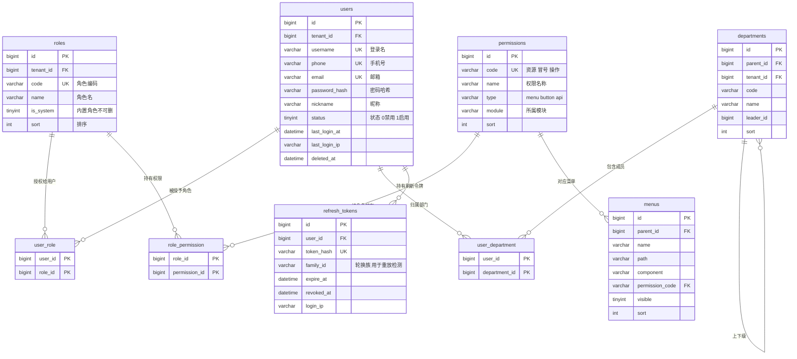
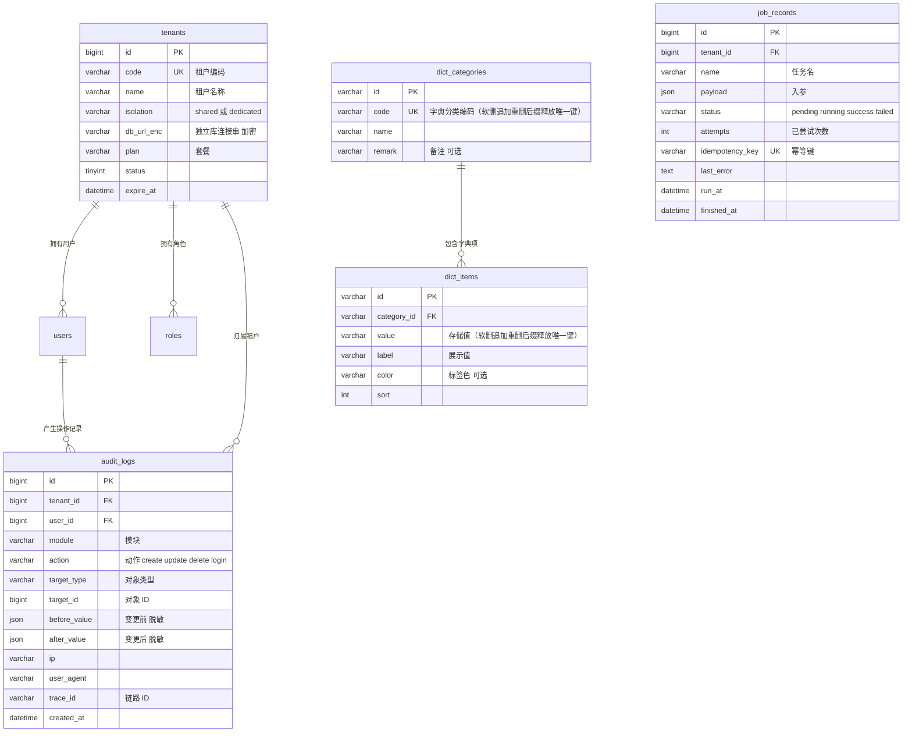

# 通用应用框架 · ER 图与数据字典

> 版本 v0.1 ｜ 状态：草案 ｜ 关联：[架构设计](./20-architecture.md) ｜ [PRD-003 鉴权](./prd/prd-003-auth-rbac.md) ｜ 更新：2026-10-14
>
> 说明：表结构按**领域分组**给出；标注 `M8` 的表属于后续里程碑，字段可能调整。`job_records` 是 M7 的规划模型，当前 memory/bullmq 实现未创建该业务表；示例业务表（`orders`）仅用于说明代码生成器的字段约定，不属于框架必需表。
> `departments` / `user_department`（§3.7/§3.8）已于 M8 T-M8-04 落地（含数据权限四档解析），主键为 UUID 字符串（与 M3 各表一致，字典中的 bigint 为逻辑描述）。

## 1. 建模约定

### 1.1 命名规范

| 对象 | 规则 | 示例 |
|---|---|---|
| 表名 | 小写下划线、复数；**框架表不带前缀**（`users`、`roles`、`dict_items`），业务表可带模块前缀（`order_items`） | `users`、`sys_dict_items` → 框架表统一用 `dict_items` |
| 字段名 | 小写下划线 | `created_at`、`tenant_id` |
| 外键 | `<单表>_id` | `role_id`、`user_id` |
| 关联表 | `<主体>_<客体>`（语义顺序，非字母序） | `user_role`、`role_permission`、`user_department` |
| 布尔字段 | `is_` 前缀 | `is_system`、`is_enabled` |
| 时间字段 | `_at` 后缀 | `last_login_at`、`expire_at` |
| 索引 | `idx_<表>_<字段>` / `uk_<表>_<字段>` | `uk_users_username` |

### 1.2 通用字段（除关联表外所有表必备）

| 字段 | 类型 | 说明 |
|---|---|---|
| `id` | bigint | 主键，雪花 ID 或 bigint 自增（两种策略可配，**全库统一**）；**传输与 TS 类型一律 `string`**，避免大整数精度丢失 |
| `tenant_id` | bigint | 租户 ID；shared 隔离下必填，M8 生效，M1–M7 预留并默认 0 |
| `created_by` | bigint | 创建人 |
| `updated_by` | bigint | 更新人 |
| `created_at` | datetime(3) | 创建时间 |
| `updated_at` | datetime(3) | 更新时间 |
| `deleted_at` | datetime(3) | 软删除标记，NULL 为未删除 |
| `version` | int | 乐观锁版本号，写操作 +1（**条件必选**：仅并发敏感表启用，普通表可不建） |

> 以下字典中为简洁起见，通用字段在每张表中只列差异字段 + `通用字段` 占位行，不再重复展开。

### 1.3 类型对照

| 数据库类型 | TS 类型 | 前端控件 | 校验 |
|---|---|---|---|
| `varchar(n)` / `char(n)` | `string` | 输入框 | 长度 ≤ n |
| `text` / `longtext` | `string` | 文本域 | — |
| `int` | `number` | 数字框 / 步进器 | 整数范围（仅非 ID 的计数、数量、排序值） |
| `bigint`（主键 `id` 或外键 `*_id`） | **`string`** | 只读 / 关联选择器 | 存在性校验；**禁止用 `number`**（雪花 ID 超出安全整数范围） |
| `decimal(p,s)` | `string`（金额禁止用浮点） | 金额框 | 精度校验，字符串传输（见 [API 1.1](./40-api-spec.md)） |
| `tinyint(1)` / `boolean` | `boolean` | 开关 | — |
| `enum(...)` | 联合字面量 | 下拉 | 枚举值白名单 |
| `datetime(3)` / `date` | `string`（ISO 8601） | 日期时间选择器 | 时间格式 |
| `json` | `Record<string, unknown>` | JSON 编辑器（默认只读） | JSON 校验 |
| `<xx>_id` | `string` | 关联选择器 | 存在性校验 |

### 1.4 其它约定

- **金额**：一律 `decimal(18,2)`，禁止浮点；**时间**：一律 UTC 存储、展示层转本地时区。
- **软删除**：默认软删，查询自动带 `deleted_at IS NULL`；物理删除需显式声明并记审计。
- **索引**：所有外键与高频筛选字段建索引；唯一约束用 `uk_` 前缀并显式命名（便于迁移幂等）。
- **外键物理约束**：仅在同一库内、且确认不影响迁移顺序时使用；跨服务与分库场景用逻辑外键。
- **枚举**：优先用 `dict_items` 字典（可运营配置），仅不变的技术枚举用数据库 `enum`。

## 2. ER 图

### 2.1 权限与组织域（M3 建立，M8 扩展组织）

### 2.2 系统与租户域（审计 M3、租户 M8、任务 M7）

## 3. 数据字典

### 3.1 `users` 用户（M3）

| 字段 | 类型 | 必填 | 默认 | 说明 | 索引 |
|---|---|---|---|---|---|
| `id` | bigint | 是 | — | 主键 | PK |
| `tenant_id` | bigint | 是 | 0 | 租户 ID（M8） | `idx_users_tenant` |
| `username` | varchar(64) | 是 | — | 登录名，3–32 位 | UK |
| `phone` | varchar(20) | 否 | NULL | 手机号 | UK（非空时唯一） |
| `email` | varchar(128) | 否 | NULL | 邮箱 | UK（非空时唯一） |
| `password_hash` | varchar(255) | 是 | — | Argon2id 哈希，永不明文 | — |
| `nickname` | varchar(64) | 否 | NULL | 昵称 | — |
| `avatar` | varchar(255) | 否 | NULL | 头像地址 | — |
| `status` | tinyint | 是 | 1 | 0 禁用 / 1 启用 | `idx_users_status` |
| `last_login_at` | datetime(3) | 否 | NULL | 最近登录时间 | — |
| `last_login_ip` | varchar(45) | 否 | NULL | 最近登录 IP（IPv6 兼容） | — |
| 通用字段 | — | — | — | `created_by/updated_by/created_at/updated_at/deleted_at` | — |

### 3.2 `roles` 角色（M3）

| 字段 | 类型 | 必填 | 默认 | 说明 | 索引 |
|---|---|---|---|---|---|
| `id` | bigint | 是 | — | 主键 | PK |
| `tenant_id` | bigint | 是 | 0 | 租户 ID | `idx_roles_tenant` |
| `code` | varchar(64) | 是 | — | 角色编码，如 `admin` | UK（租户内唯一） |
| `name` | varchar(64) | 是 | — | 角色名 | — |
| `remark` | varchar(255) | 否 | NULL | 备注 | — |
| `is_system` | tinyint | 是 | 0 | 内置角色不可删除 | — |
| `data_scope` | varchar(20) | 是 | `self` | 数据范围：`all` / `org_below` / `org` / `self` | — |
| `sort` | int | 是 | 0 | 排序 | — |
| 通用字段 | — | — | — | 同上 | — |

### 3.3 `permissions` 权限点（M3）

| 字段 | 类型 | 必填 | 默认 | 说明 | 索引 |
|---|---|---|---|---|---|
| `id` | bigint | 是 | — | 主键 | PK |
| `code` | varchar(128) | 是 | — | `资源:操作`，如 `order:refund` | UK |
| `name` | varchar(64) | 是 | — | 权限名称 | — |
| `type` | varchar(16) | 是 | `api` | `menu` / `button` / `api` | `idx_permissions_type` |
| `module` | varchar(64) | 否 | NULL | 所属模块，便于分组展示 | `idx_permissions_module` |
| `sort` | int | 是 | 0 | 排序 | — |
| 通用字段 | — | — | — | 同上 | — |

### 3.4 `user_role` 用户-角色（M3，关联表）

| 字段 | 类型 | 必填 | 说明 | 索引 |
|---|---|---|---|---|
| `user_id` | bigint | 是 | 用户 ID | 联合 PK + `idx_ur_role` |
| `role_id` | bigint | 是 | 角色 ID | 联合 PK + `idx_ur_user` |

### 3.5 `role_permission` 角色-权限（M3，关联表）

| 字段 | 类型 | 必填 | 说明 | 索引 |
|---|---|---|---|---|
| `role_id` | bigint | 是 | 角色 ID | 联合 PK |
| `permission_id` | bigint | 是 | 权限 ID | 联合 PK |

### 3.6 `menus` 菜单（M3，供后台动态路由）

| 字段 | 类型 | 必填 | 默认 | 说明 | 索引 |
|---|---|---|---|---|---|
| `id` | bigint | 是 | — | 主键 | PK |
| `parent_id` | bigint | 是 | 0 | 父菜单，0 为顶级 | `idx_menus_parent` |
| `name` | varchar(64) | 是 | — | 菜单名 | — |
| `path` | varchar(255) | 否 | NULL | 前端路由 | — |
| `component` | varchar(255) | 否 | NULL | 前端组件路径 | — |
| `icon` | varchar(64) | 否 | NULL | 图标 | — |
| `permission_code` | varchar(128) | 否 | NULL | 关联权限点，控制可见性 | `idx_menus_perm` |
| `visible` | tinyint | 是 | 1 | 是否显示 | — |
| `sort` | int | 是 | 0 | 排序 | — |
| 通用字段 | — | — | — | 同上 | — |

### 3.7 `departments` 组织部门（M8）

| 字段 | 类型 | 必填 | 默认 | 说明 | 索引 |
|---|---|---|---|---|---|
| `id` | bigint | 是 | — | 主键 | PK |
| `parent_id` | bigint | 是 | 0 | 上级部门；'0' 为顶级 | `idx_dept_parent` |
| `tenant_id` | bigint | 是 | 0 | 租户 ID | `idx_dept_tenant` |
| `code` | varchar(64) | 否 | NULL | 部门编码 | UK（租户内唯一） |
| `name` | varchar(64) | 是 | — | 部门名 | — |
| `leader_id` | bigint | 否 | NULL | 负责人（users.id） | — |
| `sort` | int | 是 | 0 | 排序 | — |
| 通用字段 | — | — | — | 同上 | — |

> 实现说明（M8 T-M8-04）：与 users/roles 等 M3 表同构，主键与外键均为 UUID 字符串（字典中的 bigint 为逻辑描述）。
> 数据权限四档语义（PRD-008 FR-04）：`org` = 本人所在部门成员；`org_below` = 所在部门及全部下级（闭包，经 `@fw/auth` 的 `collectDescendantIds` 计算）；
> 用户无部门归属时一律收敛为 `self`（fail-closed）。部门树暂不提供维护端点，由种子与运维脚本维护（Backlog）。

### 3.8 `user_department` 用户-部门（M8，关联表，支持多部门）

| 字段 | 类型 | 必填 | 说明 | 索引 |
|---|---|---|---|---|
| `user_id` | bigint | 是 | 用户 ID | 联合 PK |
| `department_id` | bigint | 是 | 部门 ID | 联合 PK |
| `is_primary` | tinyint | 否 | 是否主部门（默认 0） | — |

### 3.9 `refresh_tokens` 刷新令牌（M3）

| 字段 | 类型 | 必填 | 默认 | 说明 | 索引 |
|---|---|---|---|---|---|
| `id` | bigint | 是 | — | 主键 | PK |
| `user_id` | bigint | 是 | — | 用户 ID | `idx_rt_user` |
| `token_hash` | varchar(255) | 是 | — | 令牌哈希（不存明文） | UK |
| `family_id` | varchar(64) | 是 | — | 轮换族 ID，复用旧令牌即判定泄漏 | `idx_rt_family` |
| `expire_at` | datetime(3) | 是 | — | 过期时间（默认 7 天） | `idx_rt_expire` |
| `revoked_at` | datetime(3) | 否 | NULL | 撤销时间（登出/轮换/踢下线） | — |
| `login_ip` | varchar(45) | 否 | NULL | 登录 IP | — |
| `user_agent` | varchar(255) | 否 | NULL | 客户端标识 | — |
| 通用字段 | — | — | — | 同上 | — |

> 清理策略：过期 30 天以上的记录由定时任务清理。

### 3.10 `tenants` 租户（M8）

| 字段 | 类型 | 必填 | 默认 | 说明 | 索引 |
|---|---|---|---|---|---|
| `id` | bigint | 是 | — | 主键 | PK |
| `code` | varchar(64) | 是 | — | 租户编码（子域名/请求头匹配） | UK |
| `name` | varchar(128) | 是 | — | 租户名称 | — |
| `isolation` | varchar(16) | 是 | `shared` | `shared`（共享库 + tenant_id）/`dedicated`（独立库） | — |
| `db_url_enc` | varchar(512) | 否 | NULL | 独立库连接串（加密存储，仅 dedicated 使用） | — |
| `plan` | varchar(32) | 否 | NULL | 套餐 | — |
| `status` | tinyint | 是 | 1 | 0 停用 / 1 启用 | — |
| `expire_at` | datetime(3) | 否 | NULL | 到期时间 | — |
| 通用字段 | — | — | — | 同上 | — |

> `db_url_enc` 加密格式（M8 T-M8-02）：AES-256-GCM 认证加密，密文形态 `v1.<iv-b64url>.<tag-b64url>.<ct-b64url>`；
> 密钥取环境变量 `TENANT_DB_KEY`（64 位十六进制或 base64，缺省用内置开发密钥并告警，生产必须显式配置）。
> 解密只发生在租户存储适配层，明文经进程内请求上下文传递给数据源路由，禁止写入日志/审计/队列消息。
> sqlite 相对路径（`file:./xxx.db`）按 `prisma/schema.prisma` 所在目录解析，与主库 `DB_URL` 语义一致。

### 3.11 `dict_categories` 字典分类（M5 契约声明，2026-10-14 落地）

| 字段 | 类型 | 必填 | 默认 | 说明 | 索引 |
|---|---|---|---|---|---|
| `id` | varchar(36) | 是 | uuid | 主键（框架统一字符串主键，D-04） | PK |
| `code` | varchar(64) | 是 | — | 分类编码，如 `order_status`、`user_status` | UK（全局唯一） |
| `name` | varchar(64) | 是 | — | 分类名称 | — |
| `remark` | varchar(255) | 否 | NULL | 备注 | — |
| 通用字段 | — | — | — | 含软删 / 审计字段 | `idx_dict_cat_deleted` |

> 与 `permissions` / `menus` 同属**系统级配置**，故不带 `tenant_id`（多租户下字典全局共享，与 D-03「框架表不带前缀」一致）。
> 软删时 `code` 追加重删后缀释放唯一键——否则同编码分类永远无法重建（人员复用场景直接撞 409）。

### 3.12 `dict_items` 字典项（M5 契约声明，2026-10-14 落地）

| 字段 | 类型 | 必填 | 默认 | 说明 | 索引 |
|---|---|---|---|---|---|
| `id` | varchar(36) | 是 | uuid | 主键 | PK |
| `category_id` | varchar(36) | 是 | — | 所属分类 | `idx_dict_item_category` |
| `value` | varchar(64) | 是 | — | 存储值（程序值） | UK（分类内唯一） |
| `label` | varchar(64) | 是 | — | 展示文案 | — |
| `color` | varchar(32) | 否 | NULL | 标签色，取值 `primary/success/warning/danger/info` | — |
| `sort` | int | 是 | 0 | 排序 | — |
| 通用字段 | — | — | — | 含软删 / 审计字段 | `idx_dict_item_deleted` |

> 契约（C-06 §3.6）不含 `is_default`：默认值由前端表单自行决定，落库会把「展示策略」固化进数据层，故不建。
> 软删时 `value` 追加重删后缀释放 `(category_id, value)` 唯一键，理由同分类。
> 种子基线四类：`user_status`（用户管理页）、`data_scope`（角色数据范围四档）、`audit_action`（审计筛选）、`order_channel`（订单演示页）。

### 3.13 `audit_logs` 审计日志（M3）

| 字段 | 类型 | 必填 | 默认 | 说明 | 索引 |
|---|---|---|---|---|---|
| `id` | bigint | 是 | — | 主键 | PK |
| `tenant_id` | bigint | 是 | 0 | 租户 ID | `idx_audit_tenant` |
| `user_id` | bigint | 否 | NULL | 操作人（系统任务为 NULL） | `idx_audit_user` |
| `module` | varchar(64) | 是 | — | 模块名 | — |
| `action` | varchar(32) | 是 | — | `create` / `update` / `delete` / `login` / `export` | `idx_audit_action` |
| `target_type` | varchar(64) | 否 | NULL | 对象类型 | `idx_audit_target` |
| `target_id` | bigint | 否 | NULL | 对象 ID | `idx_audit_target` |
| `before_value` | json | 否 | NULL | 变更前（脱敏后） | — |
| `after_value` | json | 否 | NULL | 变更后（脱敏后） | — |
| `ip` | varchar(45) | 否 | NULL | 来源 IP | — |
| `user_agent` | varchar(255) | 否 | NULL | 客户端标识 | — |
| `trace_id` | varchar(64) | 否 | NULL | 链路 ID，串联日志 | `idx_audit_trace` |
| `created_at` | datetime(3) | 是 | — | 操作时间（仅创建，不更新不删除） | `idx_audit_created` |

> 保留期默认 180 天可配；量大时按月分区或归档冷存；查询页按 `user_id + created_at` 组合查询。

### 3.14 `job_records` 任务记录（M7）

> 规划模型，M7 实现未迁移此表：memory 驱动在进程内持有任务，bullmq 驱动由 Redis 持有任务。需要业务进度持久化时由业务模块自建记录。

| 字段 | 类型 | 必填 | 默认 | 说明 | 索引 |
|---|---|---|---|---|---|
| `id` | bigint | 是 | — | 主键 | PK |
| `tenant_id` | bigint | 是 | 0 | 租户 ID | — |
| `name` | varchar(64) | 是 | — | 任务名 | `idx_job_name` |
| `payload` | json | 否 | NULL | 入参 | — |
| `status` | varchar(16) | 是 | `pending` | `pending` / `running` / `success` / `failed` | `idx_job_status` |
| `attempts` | int | 是 | 0 | 已尝试次数 | — |
| `idempotency_key` | varchar(128) | 否 | NULL | 幂等键 | UK（非空时唯一） |
| `last_error` | text | 否 | NULL | 最近一次失败原因 | — |
| `run_at` | datetime(3) | 否 | NULL | 计划执行时间（延时任务） | `idx_job_run` |
| `finished_at` | datetime(3) | 否 | NULL | 完成时间 | — |
| 通用字段 | — | — | — | 同上 | — |

### 3.15 示例业务表 `orders`（演示生成器约定）

| 字段 | 类型 | 必填 | 默认 | 说明 | 索引 |
|---|---|---|---|---|---|
| `id` | bigint | 是 | — | 主键 | PK |
| `order_no` | varchar(32) | 是 | — | 订单号 | UK |
| `user_id` | bigint | 是 | — | 下单用户（外键语义） | `idx_order_user` |
| `amount` | decimal(18,2) | 是 | 0 | 金额 | — |
| `status` | varchar(24) | 是 | `pending` | 状态，取值来自 `dict_items` | `idx_order_status` |
| `paid_at` | datetime(3) | 否 | NULL | 支付时间 | — |
| 通用字段 | — | — | — | 含 `tenant_id` / 软删 / 审计字段 | — |

> 生成器依据此约定产出：后端 Entity/DTO/Service/Controller、前端列表与表单、四个权限点（`order:create/read/update/delete`）与菜单 seed。

## 4. 迁移与数据治理

- 一次变更一个 migration，命名 `<序号>_<动作>_<表>`；禁止修改已提交迁移文件。
- 破坏性变更分两步：先加新字段并双写 → 再切读 → 最后删旧字段（跨版本可回滚）。
- 种子数据 `db:seed` 初始化：内置角色（admin/guest）、权限点、字典分类、菜单。
- 审计与日志类表不物理删，按保留期归档；用户表软删，账号保留以便追溯。
- 所有跨库外键仅作**逻辑外键**，避免分库与拆服务时的迁移阻塞。
