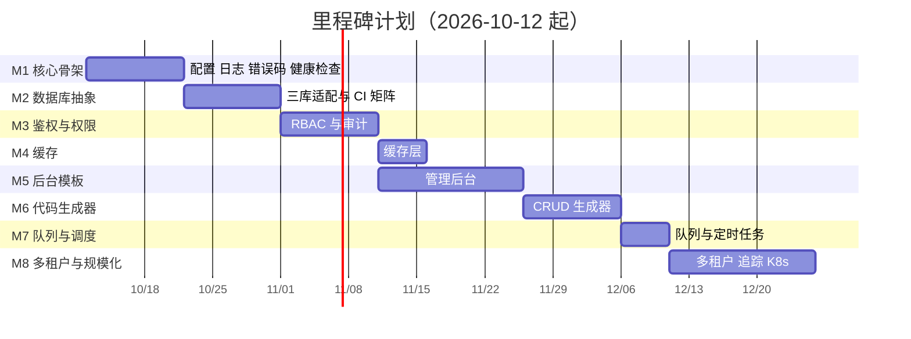

# 项目计划与任务板

> 版本 v0.1 ｜ 状态：草案（计划基线，开工后按周更新） ｜ 更新：2026-10-09
>
> 关联：[里程碑 PRD](./prd/README.md) ｜ [验收标准](./10-acceptance-criteria.md) ｜ [测试用例](./50-test-cases.md) ｜ [编码/Git/PR 规范](./70-engineering-standards.md)

## 1. 计划总览

- **总周期**：15 周（2026-10-12 → 2027-01-22），按 8 个里程碑推进，每里程碑结束做一次门禁验收。
- **人力基线**：后端 2 人、前端 1 人、测试 0.5 人、运维兼职（按需）。可按人力增减压缩或拉长，但**里程碑顺序与依赖不可跳过**。
- **关键路径**：M1 → M2 → M3 → M5 → M6 → M7 → M8（M4 可与 M3/M5 并行，不占关键路径）。

## 2. WBS 任务分解

> 估时单位：人日（含自测与文档）。每里程碑预留 **20% 缓冲**，未列入单任务。

### M1 核心骨架（PRD-001）

| 任务 ID | 任务 | 产出 | 人日 | 依赖 | 验收 |
|---|---|---|---|---|---|
| T-M1-01 | monorepo 骨架与 turbo 编排 | `pnpm-workspace.yaml`、`turbo.json`、包目录 | 1 | — | `pnpm build` 全包通过 |
| T-M1-02 | `@fw/config` 配置校验 | zod schema、`ConfigService`、`.env.example` | 2 | T-M1-01 | TC-CORE-001/002 |
| T-M1-03 | `@fw/logger` 结构化日志与脱敏 | Logger、脱敏规则 | 2 | T-M1-02 | TC-CORE-005 |
| T-M1-04 | 统一响应、错误码与全局异常过滤 | 拦截器、过滤器、错误码表 | 2 | T-M1-03 | TC-CORE-004 |
| T-M1-05 | traceId 中间件与异步上下文 | 中间件、AsyncLocalStorage | 2 | T-M1-03 | TC-CORE-003 |
| T-M1-06 | 健康检查与优雅停机 | `/health`、`/ready`、shutdown 钩子 | 1.5 | T-M1-02 | TC-CORE-006/007 |
| T-M1-07 | `@fw/cli` 基础命令 | `new/dev/build/check` | 2 | T-M1-01 | 模板项目 30 分钟跑通 |
| T-M1-08 | M1 验收演示 | 演示 + 验收记录 | 0.5 | 全部 | M1 门禁全绿 |

### M2 数据库抽象（PRD-002）

| 任务 ID | 任务 | 产出 | 人日 | 依赖 | 验收 |
|---|---|---|---|---|---|
| T-M2-01 | ORM 选型验证与 ADR-0002 定稿 | 对比报告、ADR 定稿 | 3 | M1 | ADR-0002 状态改为已采纳 |
| T-M2-02 | `Repository<T>` 接口与分页/软删/事务 | 接口定义 + 文档 | 2 | M1 | 接口冻结评审通过 |
| T-M2-03 | 三驱动适配（mysql/postgres/sqlite） | 适配器实现 | 4 | T-M2-01/02 | TC-ORM-001 |
| T-M2-04 | 方言白名单与原生 SQL 静态检查 | 白名单文档 + lint 规则 | 2 | T-M2-02 | TC-ORM-005 |
| T-M2-05 | 迁移工具与 seed | `db:migrate/rollback/seed` | 2 | T-M2-03 | TC-ORM-007 |
| T-M2-06 | 连接池、慢查询与 `/ready` 探针接入 | 观测接入 | 1.5 | T-M2-03 | TC-ORM-006 |
| T-M2-07 | CI 三库测试矩阵 | 流水线配置 | 2 | T-M2-03 | 三库并行全绿 |
| T-M2-08 | 数据库切换演练与验收 | 演练记录 | 1 | 全部 | TC-ORM-008 |

### M3 鉴权与权限（PRD-003）

| 任务 ID | 任务 | 产出 | 人日 | 依赖 | 验收 |
|---|---|---|---|---|---|
| T-M3-01 | 用户/角色/权限五表与迁移 | 迁移 + seed | 2 | M2 | 表结构与字典一致 |
| T-M3-02 | 登录/登出/改密与密码策略 | 接口 + Argon2 | 3 | T-M3-01 | TC-AUTH-001/002 |
| T-M3-03 | 双 token、轮换与黑名单 | refresh_tokens、黑名单 | 3 | T-M3-02 | TC-AUTH-006/007/008/010 |
| T-M3-04 | RBAC 守卫与 `@Permissions` 装饰器 | 守卫、装饰器 | 2 | T-M3-01 | TC-AUTH-003/004/009 |
| T-M3-05 | Passport 多策略（jwt/session/oauth2/apikey） | 策略实现 | 3 | T-M3-03 | TC-AUTH-012 |
| T-M3-06 | 审计日志 | audit_logs + 拦截器 | 2 | T-M3-01 | TC-AUTH-011 |
| T-M3-07 | 登录限流、锁定与密钥轮换 | 安全加固 | 2 | T-M3-02 | TC-AUTH-002/014 |
| T-M3-08 | M3 验收演示（含越权用例） | 演示 + 记录 | 0.5 | 全部 | M3 门禁全绿 |

### M4 缓存层（PRD-004）

| 任务 ID | 任务 | 产出 | 人日 | 依赖 | 验收 |
|---|---|---|---|---|---|
| T-M4-01 | `CacheService` 接口与 memory 驱动 | 接口 + 实现 | 2 | M1 | TC-CACHE-002 |
| T-M4-02 | redis / cluster 驱动与切换 | 驱动实现 | 2 | T-M4-01 | TC-CACHE-001 |
| T-M4-03 | `@Cacheable` 装饰器与 key 规范 | 装饰器、命名规则 | 1.5 | T-M4-01 | 接口层无侵入 |
| T-M4-04 | 标签化失效 | tag 映射与失效 | 2 | T-M4-01 | TC-CACHE-003 |
| T-M4-05 | 穿透/击穿/雪崩防护 | 空值、单飞、抖动 | 2 | T-M4-01 | TC-CACHE-004/005/006 |
| T-M4-06 | 分布式锁 | Lock API | 1.5 | T-M4-02 | TC-CACHE-009 |
| T-M4-07 | 降级与指标 | `CACHE_FAIL_OPEN`、`/metrics` | 2 | T-M4-02 | TC-CACHE-007/008 |

### M5 管理后台模板（PRD-005）

| 任务 ID | 任务 | 产出 | 人日 | 依赖 | 验收 |
|---|---|---|---|---|---|
| T-M5-01 | 前端工程与布局主题 | Vite 工程、布局 | 3 | M1 | 构建产物可托管 |
| T-M5-02 | 请求层与无感刷新 | request 封装 | 2 | T-M5-01 | TC-WEB-003 |
| T-M5-03 | 登录页与个人中心 | 页面 | 2 | T-M5-02 | E2E 登录通过 |
| T-M5-04 | 动态路由与按钮权限 | 路由生成、`v-permission` | 3 | M3、T-M5-02 | TC-WEB-001/002 |
| T-M5-05 | 用户/角色/权限/菜单管理页 | 4 个管理页 | 4 | M3、T-M5-04 | 角色授权可用 |
| T-M5-06 | 字典管理页与 `useDict` | 页面 + hook | 1.5 | T-M5-04 | 字典消费正常 |
| T-M5-07 | 审计日志页 | 查询页 | 1.5 | M3 | TC-WEB-004 |
| T-M5-08 | `<CrudTable>` 组件 | 通用列表组件 | 3 | T-M5-01 | 新页面 ≤ 80 行 |

### M6 代码生成器（PRD-006）

> **状态：已完成（2026-10-13，未发版）**。`fw gen crud` 五层实现（解析 / 映射 / 模板引擎 / 安全写入 / 编排），模板外置 `templates/codegen/`；
> `@fw/cli` 单测 **116/116**、覆盖率 **94.69% / 91.18%**（门禁 ≥80%）；端到端以真实 schema 的 `DemoItem` 为载体验证，生成产物零手改通过后端 `tsc` 与前端 `vue-tsc`；PRD-006 §7 八条 AC 全部满足。

| 任务 ID | 任务 | 产出 | 人日 | 依赖 | 验收 | 状态 |
|---|---|---|---|---|---|---|
| T-M6-01 | 模型解析与类型映射表 | 元信息解析 | 2 | M2 | 映射覆盖全部基础类型 | ✅ |
| T-M6-02 | 后端代码模板与生成 | 模板 + 生成逻辑 | 3 | T-M6-01 | TC-GEN-001/002 | ✅ |
| T-M6-03 | 前端页面生成 | 列表/表单/API 模板 | 3 | M5、T-M6-02 | TC-GEN-001 | ✅ |
| T-M6-04 | 权限点与菜单 seed 生成 | seed 生成 | 1.5 | T-M6-02 | TC-GEN-005 | ✅ |
| T-M6-05 | dry-run、diff 与覆盖策略 | 安全写入 | 2 | T-M6-02 | TC-GEN-003/004/006 | ✅ |
| T-M6-06 | 模板定制与文档 | 模板覆盖机制 | 1.5 | T-M6-02 | TC-GEN-007 | ✅ |

### M7 队列与调度（PRD-007）

| 任务 ID | 任务 | 产出 | 人日 | 依赖 | 验收 |
|---|---|---|---|---|---|
| T-M7-01 | Job 抽象与 memory 驱动 | 接口 + 实现 | 2 | M1 | TC-JOB-001 |
| T-M7-02 | bullmq 驱动与切换 | 驱动实现 | 2 | M4、T-M7-01 | TC-JOB-001 |
| T-M7-03 | cron 调度与分布式锁 | `@Cron` | 2 | T-M7-02 | TC-JOB-002 |
| T-M7-04 | 重试退避、死信与重放 | 失败链路 | 2 | T-M7-02 | TC-JOB-003/004 |
| T-M7-05 | 幂等、限速与优雅停机 | 生产保障 | 1.5 | T-M7-02 | TC-JOB-005/006/007 |
| T-M7-06 | 队列管理页与指标 | 管理页 + 指标 | 2 | M5、T-M7-02 | 积压可视 |

### M8 多租户与规模化（PRD-008）

| 任务 ID | 任务 | 产出 | 人日 | 依赖 | 验收 |
|---|---|---|---|---|---|
| T-M8-01 | 租户上下文与 shared 隔离 | 上下文注入 | 3 | M2 | TC-TNT-003 |
| T-M8-02 | dedicated 独立库路由 | 数据源路由 | 3 | T-M8-01 | TC-TNT-003 |
| T-M8-03 | 越权防护与 fail-closed | 强制条件 | 2 | T-M8-01 | TC-TNT-001/002 |
| T-M8-04 | 组织架构与数据权限四档 | departments + scope | 3 | M3、T-M8-01 | TC-TNT-004 |
| T-M8-05 | transport 切换（in-process → redis） | 微服务通路 | 3 | M4/M7 | TC-TNT-005 |
| T-M8-06 | OpenTelemetry 接入 | 追踪导出 | 3 | M1 | TC-TNT-006 |
| T-M8-07 | Helm Chart 与部署模板 | Chart + values | 3 | 全部 | TC-TNT-007 |
| T-M8-08 | 三大演练与终验 | 演练记录 | 2 | 全部 | L3 发布门禁通过 |

## 3. 任务板

### 3.1 列定义与流转

| 列 | 含义 | 准入条件 | WIP 限制 |
|---|---|---|---|
| `Backlog` | 已知但未细化 | 有标题与里程碑 | 无 |
| `Ready` | 需求与验收明确，可认领 | 关联 PRD + AC + 测试用例，依赖已就绪 | 无 |
| `In Progress` | 开发中 | 已认领并指定责任人 | 每人 ≤ 2 |
| `In Review` | PR 待评审 | CI 已通过，描述完整 | ≤ 5 |
| `Done` | 已合并并通过验收 | DoD 全部条目勾选 | 无 |

流转：`Backlog → Ready → In Progress → In Review → Done`。被阻塞的卡片加 `blocked` 标签并回退到 `Ready`，**禁止长期停留在 In Progress**。

### 3.2 标签

| 标签 | 用途 |
|---|---|
| `M1`–`M8` | 所属里程碑 |
| `P0` / `P1` / `P2` | 优先级（P0 阻塞里程碑） |
| `feat` / `fix` / `chore` / `docs` | 类型 |
| `blocked` | 被阻塞，需注明原因与解除条件 |
| `spike` | 调研/验证任务（有时间盒，如 T-M2-01 的 3 人日） |

### 3.3 当前快照

**Done**（M1 核心骨架 + M2 数据库抽象层 + M3 鉴权与权限 + M4 缓存层，2026-10-13）

- [x] T-M1-01 monorepo 骨架与 turbo 编排
- [x] T-M1-02 `@fw/config` 配置校验
- [x] T-M1-03 `@fw/logger` 结构化日志与脱敏
- [x] T-M1-04 统一响应、错误码与全局异常过滤
- [x] T-M1-05 traceId 中间件与异步上下文
- [x] T-M1-06 健康检查与优雅停机
- [x] T-M1-07 `@fw/cli` 基础命令
- [x] T-M1-08 M1 验收演示
- [x] T-M2-01 ORM 选型验证与 ADR-0002 定稿（Prisma 6.19.3）
- [x] T-M2-02 `Repository<T>` 接口与分页/软删/事务
- [x] T-M2-03 三驱动适配（sqlite 集成测试全过；mysql/pg 走 CI 矩阵）
- [x] T-M2-04 方言白名单与原生 SQL 静态检查
- [x] T-M2-05 迁移工具与 seed（db:migrate/rollback/seed）
- [x] T-M2-06 连接池、慢查询与 `/ready` 探针接入
- [x] T-M2-07 CI 三库测试矩阵（配置就位，MySQL/PG 待 CI 执行）
- [x] T-M2-08 数据库切换演练与验收
- [x] T-M3-01 用户/角色/权限五表与迁移（+ `menus` / `refresh_tokens` / `audit_logs` 共 8 表；迁移 `20261012165848_add_auth_rbac`；seed 22 权限点 / 2 角色 / 7 菜单 / 2 账号）
- [x] T-M3-02 登录/登出/改密与密码策略（Argon2id 主 + bcrypt 兼容，`needsRehash` 静默升级；三档强度策略）
- [x] T-M3-03 双 token、轮换与黑名单（`jti` 精确黑名单 + 用户级水位 + refresh 族撤销 + 10s 并发宽限）
- [x] T-M3-04 RBAC 守卫与 `@Permissions` 装饰器（`APP_GUARD`；`@Public` / `@Permissions` / `@CurrentUser` / `@Audit`；权限缓存按 `user:<id>` 标签失效）
- [x] T-M3-05 多策略（jwt/session/oauth2/apikey）（`StrategyRegistry` 自实现，见 ADR-0011；apikey/session/oauth2 有单测，端到端仅覆盖 jwt）
- [x] T-M3-06 审计日志（`@Audit` + `APP_INTERCEPTOR` + `AuditService.record({ before, after })`；异步落盘、失败降级、敏感字段脱敏）
- [x] T-M3-07 登录限流、锁定与密钥轮换（60s/10 次限流、5 次失败锁 15 分钟、`JWT_SECRET`/`JWT_SECRET_PREV` 双密钥过渡）
- [x] T-M3-08 M3 验收演示（含越权用例）（`scripts/smoke-auth.mjs` 25/25；M1/M2 回归 13/13；AC 见 PRD-003 §10）
- [x] T-M4-01 `CacheService` 接口与 memory 驱动（自研 `CacheStore` 端口；memory 驱动零依赖，LRU + TTL 惰性淘汰；ADR-0012）
- [x] T-M4-02 redis / cluster 驱动与切换（ioredis 懒加载、可选 peerDependency；`CACHE_DRIVER=memory|redis|redis-cluster`，业务代码 diff = 0）
- [x] T-M4-03 `@Cacheable` 装饰器与 key 规范（`类名:方法名:参数哈希`；全局前缀 `CACHE_PREFIX`；字符白名单与长度校验）
- [x] T-M4-04 标签化失效（`set(..., { tags })` 登记「标签→key」集合映射；`invalidateTag` 批量失效；`CACHE_TAG_TTL` 防幽灵缓存）
- [x] T-M4-05 穿透/击穿/雪崩防护（空值占位 JSON 信封 / 单飞 `wrap` / TTL ±抖动；TC-CACHE-004/005/006）
- [x] T-M4-06 分布式锁（`Lock`：`SET NX PX`、持有者校验的安全释放、自动续期、可重入标记；memory 退化进程内锁）
- [x] T-M4-07 降级与指标（`CACHE_FAIL_OPEN` 降级直查、降级日志与 `/metrics` 指标、`/ready` 依赖探针；TC-CACHE-007/008）
- [x] T-M4-08 M4 验收演示（`scripts/smoke-cache.mjs` 12/12；`@fw/cache` 单测 8 文件，覆盖率 96.23%/94.45%；M1/M2 13/13、M3 25/25 回归通过；AC 见 PRD-004 §10）

**Done**（M5 管理后台前端，2026-10-13）

> M5 已完成实现与验证，未发版（不计入 v0.1.0）。`apps/admin-web` 全量门禁通过：
> `vue-tsc --noEmit` 类型检查 ✓；生产构建 ✓（gzip 总量 434.9 kB，门禁 600 kB）；
> vitest 单测 **29/29**（错误码语义 / 无感刷新重放与并发合并 / 权限路由生成 / CrudTable 四态与权限按钮）；
> mock 全链路冒烟 **40/40**（`scripts/smoke-mock.mjs`：登录 / me / 错误码 / 禁用账号 / 菜单 / 字典 / 用户 CRUD / 越权 3002 / 无感刷新轮换 / 角色 / 菜单树 / 审计 / 订单 / 登出）；
> 文件头校验 192 文件通过。C-06 契约冻结（`docs/contracts/api-web.ts`）。PRD-005 §7 六条 AC 全部满足。

- [x] T-M5-01 前端工程与布局主题（Vite 5 + Vue3 + TS + Element Plus 按需引入 + Pinia + Vue Router；侧边栏 / 顶栏 / 面包屑 / 多标签页、主色 / 暗色 / 紧凑、响应式；`mock/` 三件套 + C-06 契约；构建 gzip 434.9 kB）
- [x] T-M5-02 请求层与无感刷新（信封解包 / Bearer / traceId 透传 / 错误码提示；3001/3003 无感刷新，并发共用同一 Promise 并重放；access 内存 + refresh 按记住我落 local/sessionStorage；TC-WEB-003 单测覆盖）
- [x] T-M5-03 登录页与个人中心（账号密码 + 验证码钩子 + 记住我；3001/3004/9003 提示；资料修改 / 改密 / 登录设备查看与下线）
- [x] T-M5-04 动态路由与按钮权限（菜单树生成路由 + 二次过滤；静态路由仅登录 / 403 / 404 / 工作台 / 个人中心；`v-permission` + CrudTable 按钮权限；TC-WEB-001/002）
- [x] T-M5-05 用户 / 角色 / 菜单管理页（用户：CRUD + 启用禁用 + 重置密码 + 分配角色；角色：权限树勾选 + 数据范围 + 复制；菜单：树形维护，变更重新登录生效）
- [x] T-M5-06 字典管理页与 `useDict`（分类 + 项维护；`useDict(code)` 按编码消费，维护后主动失效；禁止枚举硬编码）
- [x] T-M5-07 审计日志页（按人 / 时间 / 模块查询；详情抽屉展示字段级 diff）
- [x] T-M5-08 `<CrudTable>` 标准组件（四要素配置；四态；列设置持久化；导入导出钩子；内置弹窗含服务端字段级错误回显；新列表页 ≤ 80 行，演示页 65 行）

**Done**（M6 代码生成器，2026-10-13）

> M6 已完成实现与验证，未发版（不计入 v0.1.0）。落地于 `packages/cli/src/gen/`（五层可注入 IO 实现）+ `templates/codegen/`（内置模板）：
> `@fw/cli` 单测 **116/116**、覆盖率 **94.69% / 91.18%**（门禁 ≥80%）；以仓库真实 schema 的 `DemoItem` 端到端验证
> （`fw gen crud demo-item` 产出后端 6 + 前端 3 + seed 1 共 10 文件，零手改通过 `example-api` `tsc` 与 `admin-web` `vue-tsc`）；
> 根文件头门禁 221 文件通过。PRD-006 §7 八条 AC 全部满足。

- [x] T-M6-01 模型解析与类型映射表（`schema-parser.ts` 解析 model/enum/字段属性/文档注释/块属性；`type-map.ts` 类型→TS→控件→校验唯一映射，`bigint`/`decimal` 强制 `string`，未命中类型报错）
- [x] T-M6-02 后端代码模板与生成（`template-engine.ts` 轻量引擎 + `render.ts` 计划组装；后端 entity/repository/dto/service/controller/module 六文件，Repository 继承 `@fw/db` `PrismaRepository` 无原生 SQL）
- [x] T-M6-03 前端页面生成（api 封装 + `index.vue`（`<CrudTable>` 列/查询配置推导）+ `form.vue`（独立弹窗，控件与校验同源）；外键生成带责任人与日期的 TODO）
- [x] T-M6-04 权限点与菜单 seed 生成（`prisma/seed/<model>.seed.ts` 幂等 upsert 4 权限点 + 菜单，与 PRD-003 RBAC 对齐）
- [x] T-M6-05 dry-run、diff 与覆盖策略（`writer.ts`：默认跳过已存在文件并提示 `--force`、`--dry` 与真实生成同源、脏工作区告警、校验失败回滚含清理新建文件与空目录）
- [x] T-M6-06 模板定制与文档（`templates/codegen/README.md` 定制说明；项目根同名模板优先 + `codegen.config.json` 的 `vars`/`typeOverrides`；`--all`/`--only`/`--app`/`--web`/`--schema` 与交互式选择）

**实现 Done / 验收待补**（M7 队列与定时任务，2026-10-13）

> M7 已完成实现与现有测试门禁，真实进程重启恢复演练待补，未发版（不计入 v0.1.0）。交付 `packages/queue`（`@fw/queue`）：
> 单测 **135/135**、覆盖率 **lines 94.96% / functions 90.83% / statements 93.14% / branches 86.57%**（门禁 85/85/65/85）；
> C-08 Job 契约冻结于 `docs/contracts/queue.ts`；`example-api` 队列冒烟 **27/27**（`scripts/smoke-queue.mjs` 五阶段，
> 含真实 Redis 的 bullmq 驱动全链路）；`admin-web` vue-tsc ✓、单测 **29/29**、mock 冒烟 **57/57**（新增队列管理 17 项），
> bundle gzip **311.5 kB**（门禁 600 kB）；CI 纳入 `@fw/queue` 构建与覆盖率门禁 + M7 冒烟步骤。PRD-007 §7 七条 AC 中六条已验收，bullmq 真实进程重启恢复演练待补。

- [x] T-M7-01 Job 抽象与 memory 驱动（`JobRecord` 统一抽象 + `QueueDriverPort` 端口；memory 驱动进程内零依赖：单定时器 pump + 优先级 + 延时/`runAt` + 退避重排 + 并发信号量 + 令牌桶 + 优雅停机重新入队；自研 5/6 段 cron 解析，`Intl` 时区）
- [x] T-M7-02 bullmq 驱动与切换（懒加载 + optional peer + 可操作报错；`settings.backoffStrategy` 复用任务内退避序列保证双驱动语义一致；`UnrecoverableError` 表达终态失败；支持结构桩注入供单测覆盖；`MQ_DRIVER` 一改即切，业务代码 diff = 0）
- [x] T-M7-03 cron 调度与分布式锁（`CronScheduler` 单一定时器驱动全部条目；`@Cron` 方法装饰器 + 启动期自动扫描；执行守卫端口复用 `@fw/cache` CacheService——redis 驱动天然集群单跑，进程内守卫启动期显式告警；`tick(name)` 手动触发仍走锁；三实例共享锁单测 TC-JOB-002）
- [x] T-M7-04 重试退避、死信与重放（默认退避 `1000,5000,30000`；`PermanentJobError` 终态失败不重试；死信归档/查询/单条重放/批量清理 + 可插拔告警回调，回调异常不影响队列）
- [x] T-M7-05 幂等、限速与优雅停机（`idempotencyKey` + `@Idempotent` 载荷哈希推导，成功才置位；令牌桶限速 + 并发上限；停机先停调度再等在途，超时 memory 重新入队 / bullmq 交失速检测恢复；`/metrics/queue` Prometheus 文本 + `/ready` queue 探针）
- [x] T-M7-06 队列管理页与指标（后端 `/api/v1/admin/queue/*` 11 端点 + `system:queue:list|manage` 权限；admin-web `/system/queue` 页：积压总览卡 / 队列明细 / 死信重放清理 / cron 快照与手动触发；mock `/admin/queue/*` 端点与 C-06 §3.8 契约；CI 新增 M7 冒烟步骤）

**Backlog**：M8 进行中——T-M8-01（租户三级回退上下文 / fail-closed / 冒烟 16/16）与 T-M8-02（dedicated 独立库路由 / 冒烟阶段 C 11 项）**已完成（2026-10-14）**；T-M8-03 越权防护地基随 01 落地（Repository tenantWhere + `@IgnoreTenant` + 审计），T-M8-04~08 待启动；~~M3 遗留项④（refresh 过期记录定时清理）~~——**已完成（2026-10-13）**：example-api `auth.refresh-cleanup` 定时任务（`@Cron('0 3 * * *')` 加分布式锁，过期 30 天清理，`/api/v1/auth-maintenance/refresh-cleanup` 快照端点），冒烟阶段 A 覆盖注册与手动触发。

**M7 验收待补（TC-JOB-008）——已完成（2026-10-13）**：真实 Redis 失速恢复演练通过并固化进 `smoke-queue.mjs` 阶段 F（31/31），恢复窗口 ≈ lockDuration 30s + `MQ_STALLED_MS` 检测间隔；演练暴露并修复「register 未建消费器」「ensureWorker 自递归死锁与重复建」两个框架缺陷，记录见 `docs/94-queue-stall-drill.md`。memory 驱动不承诺跨进程持久化。

> **v0.1.0 遗留项（不阻塞发布）**：① ~~`@nestjs/core <=11.1.17` 与 `file-type` 的 3 项 moderate 依赖漏洞需随 NestJS 10 → 11 升级解决~~ → **✅ 已闭环（2026-10-13）**：全仓升 NestJS **11.2.7**（Express 5.2.1 / `@types/express` 5 / file-type 21.3.4 / multer 2.4.0），`pnpm audit --prod` **零漏洞**；② ~~dev 工具链大版本升级（vitest 2→3、tinypool 1→2、happy-dom 15→20、vite 5→6）~~ → **✅ 已闭环（2026-10-13）**：vitest **4.1.11** / vite **8.3.4**（rolldown + oxc）/ happy-dom **21.0.1** / plugin-vue 6 / vue-tsc 3 / unplugin-vue-components 32，`tinypool` 随 vitest 4 整条链路消失；**全仓 `pnpm audit`（含 dev）零漏洞**，全套门禁复跑通过（框架包 366/366、example-api 50/50、admin-web 29+40）；③ ~~`braces` 暂无可用补丁版本~~ → **✅ 已消除（2026-10-13）**：`braces` 随 vite 8 不再进入依赖树，无需补丁。

> **M3 遗留项（已登记，不阻塞 M3 验收）**：① `apikey`/`session`/`oauth2` 端到端路由（M5 接入后台模板时补）；② ~~权限缓存换 Redis 多实例共享~~（**M4 已完成**：`CacheBackedAuthCache` 适配器把 `AUTH_CACHE` 端口接到 `CacheService`，鉴权业务代码 diff = 0）；③ `dataScope` 的 `org`/`org_below` 两档（M8）；④ refresh 过期记录定时清理（**M7 已具备 cron 能力，具体清理任务移入 M8 backlog**）。

## 4. 节奏与会议

| 节奏 | 时间 | 内容 |
|---|---|---|
| 周计划 | 每周一 30 分钟 | 认领任务、确认依赖与阻塞、调整优先级 |
| 周评审 | 每周五 30 分钟 | 演示已完成项、过 `In Review` 卡片、更新燃尽 |
| 里程碑验收 | 里程碑结束半天 | 逐条过门禁与 AC、跑关键演练、填写验收记录 |
| 发布 | M3 起每里程碑一次 | 打 tag、更新 CHANGELOG、按发布流程上线 |

## 5. 缓冲与风险

| 风险 | 应对 | 缓冲 |
|---|---|---|
| ADR-0002 ORM 未定稿阻塞 M2 | **已闭环**：Prisma 6.19.3 定稿（spike 实测），Repository 接口先行未阻塞 M1 | M2 内置 |
| 三库 CI 矩阵导致流水线变慢 | 本地 SQLite 单测、PR 只跑受影响包、每日跑全矩阵 | M2 内置 |
| 前端与后端契约不一致 | 权限码/菜单树/错误码三层契约先冻结并双方确认 | M5 内置 |
| 关键路径人力被占用 | M4/M7 可并行或延后；优先保 M1→M2→M3→M5 | 每里程碑 20% |
| 需求变更 | 先改 PRD 变更记录再改代码；影响评估后调整排期 | 里程碑内消化 |

## 6. 进度度量

| 指标 | 目标 | 频率 |
|---|---|---|
| 里程碑达成率 | 按计划日期或延后 ≤ 1 周 | 每里程碑 |
| AC 通过率 | 里程碑关闭时 100%（P1 条件通过需带闭环时间） | 每里程碑 |
| 燃尽图 | 趋势平稳，无长期持平 | 每周 |
| CI 通过率 | 首次运行 ≥ 90% | 每周 |
| 缺陷密度 | P0 遗留 0；P1 闭环 ≤ 5 天 | 每周 |
| 覆盖率 | 整体 ≥ 70%，auth/cache/orm ≥ 85% | 每次 PR |
